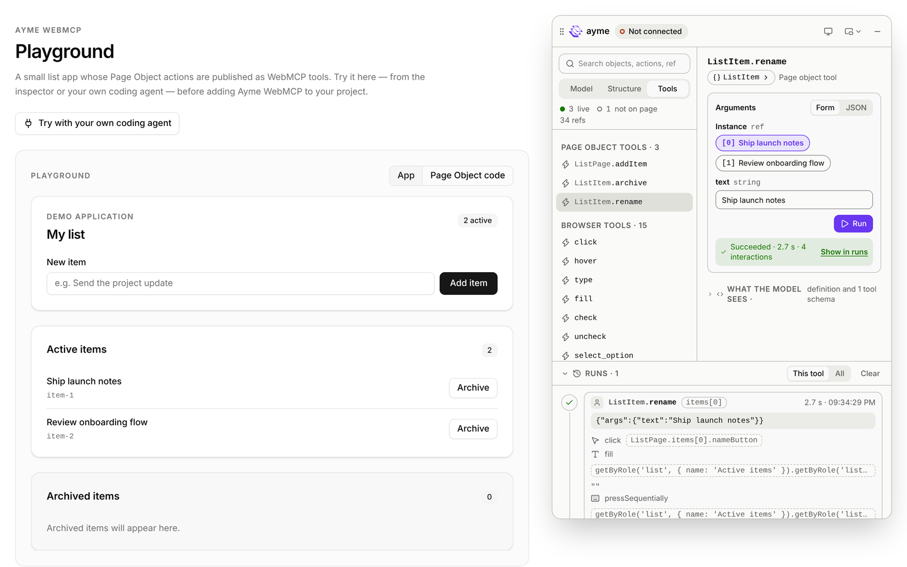

# Inspector

How to turn on the Inspector, the in-page panel that shows your Page Objects, the page state and the tools, and lets you run them by hand.

## Turn it on

Install `@ayme-dev/inspector` beside `@ayme-dev/ayme`, which declares it as an optional peer dependency:

```sh
npm install -D @ayme-dev/inspector
```

Then pass `inspector: true` where ayme starts: `useAyme` or `AymeProvider` in Vue, `AymeProvider` in React, `useAyme` in Svelte, `provideAyme` in Angular, or `createAyme`. Most apps turn it on in development only, with their framework's [development flag](#the-development-flag-per-framework):

```ts
useAyme({ inspector: import.meta.env.DEV });
```

- The option is off unless set, and there is no production guard: you decide when it is on.
- While it is on, the session loads the Inspector when it starts in the browser, mounts it, and unmounts it when it stops. Server rendering loads nothing.
- With the option off, the page requests no Inspector code.
- If the package cannot be loaded, the error names `@ayme-dev/inspector`.
- The Inspector reaches Page Objects constructed before it loaded.
- It works whether WebMCP publication is on or off.
- It turns the page's [Peeks](../reference/ayme.md#aymepeek) on, as `agentConnection` does.

### The development flag per framework

| Framework                | Development flag                                            | Setup                                                                                                                                                                |
| ------------------------ | ----------------------------------------------------------- | -------------------------------------------------------------------------------------------------------------------------------------------------------------------- |
| Vite: React, Vue, Svelte | `import.meta.env.DEV`                                       | [React](../frameworks/react.md#start-ayme-at-the-root), [Vue](../frameworks/vue.md#start-ayme-at-the-root), [Svelte](../frameworks/svelte.md#start-ayme-at-the-root) |
| Angular                  | `isDevMode()` from `@angular/core`                          | [Angular](../frameworks/angular.md#start-ayme-in-the-application-config)                                                                                             |
| SvelteKit                | `dev` from `$app/environment`, or `$app/env` on SvelteKit 3 | [Svelte](../frameworks/svelte.md#start-ayme-at-the-root)                                                                                                             |
| Next.js                  | `process.env.NODE_ENV === "development"`                    | [React: Server rendering](../frameworks/react.md#server-rendering)                                                                                                   |
| Nuxt                     | `import.meta.dev`                                           | [Vue: Server rendering](../frameworks/vue.md#server-rendering)                                                                                                       |

With Vite, a development build you serve without a dev server, such as static files, comes from `NODE_ENV=development vite build`. `vite build --mode development` alone still builds with `NODE_ENV=production`, so `import.meta.env.DEV` is `false` and the Inspector stays off.

## In a window of its own

### On a Session: `ayme inspect`

With a [Session](connect-an-agent.md) running, `ayme inspect` opens the Inspector on it in your default browser:

```sh
ayme inspect
```

The window is served by the Session's own process and usually opens outside the Session's browser, so it never shows up in your browser automation's snapshots. When the Session joined your default browser with `ayme attach`, the window opens there as one more tab, which your browser automation can see but ayme never takes for its Tab. Nothing has to be in your app, and nothing more to install: the Inspector comes with `@ayme-dev/cli`.

- It shows the Page Objects and the Page Object Tools of the Session's Tab, and follows the browser to another Tab.
- Run a tool by hand from it. Runs records it as run by you from the Inspector. It is one Run like an agent's `ayme call`: a Tab runs one at a time, so it waits for the Run under way there, and a call waits for it.
- Hovering or selecting a Page Object highlights it on the Session's page. There is no picking: a Session's tools take no element ref.
- Closing the window leaves the Session as it was. When the Session ends, the window says so; start a new one and run `ayme inspect` again.
- `-s=<name>` opens the Inspector of the Session of that name, as for the other commands.
- `BROWSER=none ayme inspect` only prints the window's address. Another `BROWSER` names the program that opens it.
- The address opens one window, within five minutes. That window stays connected when you reload it, unless the browser blocks storage for the tab; for another window, or after such a reload, run `ayme inspect` again.
- When the program that opens it cannot start, or fails within two seconds, `ayme inspect` exits with code 1 and prints the address to open by hand.

### In your Agent App's chat: `ayme mcp`

An Agent App that shows MCP Apps, such as Cursor, Claude Desktop or T3 Code, shows the same Inspector in its chat. Register `ayme mcp` in your project's MCP configuration, such as `.mcp.json` for Claude Code, and run it [as the other commands](connect-an-agent.md#connect-ayme-and-the-browser-automation-to-one-browser):

```json
{
  "mcpServers": {
    "ayme": {
      "command": "npx",
      "args": ["ayme", "mcp"]
    }
  }
}
```

Then ask the agent to show you the Inspector. It calls `ayme_inspect`, and the Agent App shows the Inspector of the Session under that call, about 600 pixels high, with a fullscreen button where the Agent App offers fullscreen.

- `ayme_inspect` is the only tool `ayme mcp` offers, and it reads nothing from the page and acts on nothing. The agent reaches your Page Object Tools through `ayme page-objects`, `ayme tools` and `ayme call`.
- The Inspector in the chat works as the window of `ayme inspect`: the same lenses and Tab, and a tool you run from it is a Run by you from the Inspector.
- `ayme mcp` can start before any Session: each call of `ayme_inspect` looks for the Session then. With none open, the call and the Inspector in the chat say how to start one; start it, and ask for the Inspector again.
- `-s=<name>` in the registration's `args`, or `AYME_SESSION` in its `env`, picks the Session of that name.
- When the Session ends, the Inspector in the chat says so and connects no more. Start a Session and ask for the Inspector again.
- The page the Agent App shows holds the key to the Session's Inspector, so whoever can read that page can use the Inspector until the Session ends. An Agent App that lets its model read MCP resources, or records them in a trace, gives the agent that key, and an agent that can also open local network connections could then run your Page Object Tools as Runs listed as run by you from the Inspector.
- An Agent App that does not show MCP Apps gets only a sentence from `ayme_inspect`. Run `ayme inspect` for a window.

### For a page that ships ayme

The panel of a page that runs ayme itself can run outside the page too. Pass `inspector: { placement: "external" }`. The default placement is `"inline"`, which `true` and `{ demo }` also give. With `"external"`, the page mounts no panel. It serves the Inspector over its [Agent Connection](connect-an-agent.md) instead, and the option turns that connection on. So a coding agent's `ayme mcp` has to be running and paired with the tab:

```ts
useAyme({ inspector: { placement: "external" } });
```

`ayme mcp` serves the Inspector on the server it already runs, with no other server or port. Ask the agent for `ayme_inspect`; it gives the URL, such as `http://127.0.0.1:9350/inspector`. Open it in a browser window beside the app. It shows the same lenses for the page connected to that server, follows the page across reloads, and works while `ayme mcp` runs. Highlighting and picking work across the two windows. A tool's ref field lets you pick an element by pointing at the page. The highlight and the pick happen in the app's tab.

- Install `@ayme-dev/inspector` where `ayme mcp` runs, as in the first section. Without it, `ayme_inspect` says to install it.
- The page keeps no Inspector code for it; the window loads the Inspector from the server.
- The window shows the page's host as "page", since it does not know the page's address.
- A window with no page to show says so: pair a page with that `ayme mcp`, and start the page's session with `placement: "external"`. A page on the default inline placement serves nothing to it.

## Demo mode

To show people what an agent does, pass `inspector: { demo: true }`:

```ts
useAyme({ inspector: { demo: true } });
```

Demo mode works in either placement. It pauses briefly before each action, though not before a scroll, and shows a cue where each click lands. It applies to every call while it is on, whether it comes from the panel, an agent or WebMCP. `inspector: true` turns the Inspector on without it, so calls run at full speed; Runs records them either way.

## The three lenses

The navigator has three lenses:

- **Model**: the Page Objects on the page and the Page Object Models it knows, with their declared [Page Object Children](ayme-page-objects.md#aymechild), each with its description and its state on the page, such as `3 matches`.
- **Structure**: the Structural Page State an agent receives, each node tagged with the member it maps to; an element of a Locator collection by its index, such as `filterChips[1]`.
- **Tools**: every tool of the page, grouped as Page object, Custom, Browser, Peek and Agent tools. A Page Object Tool that cannot run now shows dimmed, with its reason under its name; Run stays enabled, so you can check the refusal. A tool marked [destructive](../reference/ayme.md#destructive-actions) shows a warning icon in the list and a Destructive mark beside its name, and so does its action in the Model lens; Run runs it like any other. Peek tools lists the page's own [Peeks](../reference/ayme.md#aymepeek) under Browser. While the tab is paired with a coding agent's ayme MCP server, it also lists the Peeks of the App Processes paired beside it, under Node. The panel runs those through that server.

Selecting anything opens its detail. A tool's page and a structure node's detail also show what the model sees of them: the definitions, page state and schemas an agent gets.

## Running tools

Every detail runs its tools through the same run card. For a Page Object Tool on several components, you pick the instance first:



**Runs** lists every Run on the page, whoever started it: you from the panel, an agent, or the app. Each Run shows:

- for a single Browser Tool input: its action, target and value together;
- for Custom and multi-input tools: their Interactions, such as clicks and fills, before the result;
- each target by its Page Object member when registered, including an element of a Locator collection by its index, such as `filterChips[1]`. Otherwise it shows the target's accessible role and name or direct text, with a containing Page Object as context when known;
- its other arguments, and its result, which you can expand and copy;
- the Runs it started, underneath it. A goal Run shows the Runs its steps executed, and a Custom Tool the Runs it started, each with its own Interactions.

Captured target names stay readable after the element disappears or the page reloads.

## The panel

The panel floats, docks to the left, right or bottom of the page, or collapses to the ayme logo. It remembers its layout, sizes, positions and theme per site. Within a tab, a reload brings back the open lens, the selection, the Runs region and the newest 50 runs. A selected structure node goes back to the page, because its ref can name another element after a reload. Its theme follows the system until you change it. While docked, it pads the page's root on that side so the panel sits beside the page.

The pill after the panel's title says whether a coding agent is connected to the tab through the Agent Connection, and names it: Claude Code, Codex, Cursor, or the name any other agent's MCP client gives. It reads:

| Pill             | When                                                                          |
| ---------------- | ----------------------------------------------------------------------------- |
| the agent's name | an agent is connected                                                         |
| Not connected    | `agentConnection` is on and no agent is connected                             |
| Reconnecting     | up to 10 seconds after the tab loses its agent's server, while it tries again |
| No agent         | `agentConnection` is off                                                      |

Open it for both ways agents reach the page, the Agent Connection and WebMCP: each says whether it is on and working, why not, and the option that turns it on. A mark on the pill's corner means WebMCP is on but cannot publish.

A Session's Inspector, in a window or in a chat, has no pill: no agent reaches a Session through the Agent Connection or WebMCP.

It paints above the page's own UI; only the browser's top layer, such as modal dialogs, popovers and fullscreen, covers it. Outside the panel and the collapsed logo, the page keeps its pointer. When an agent's pointer action targets something under the panel, the action passes through it.

## What it never changes

The Inspector keeps its view live without recording anything an agent would see, so it never changes the page state, the Change Records or the interaction history an agent gets.

It lives in a closed Shadow Root on an `<ayme-inspector>` element at the end of the body. Its styles stay inside it, and no locator on the page, Playwright's or ayme's, sees inside it, so a Page Object member never matches the Inspector's own text. The page state capture leaves the Inspector out. It bundles its own React, so a host app of any framework or React version never shares it.
