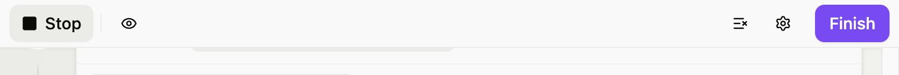
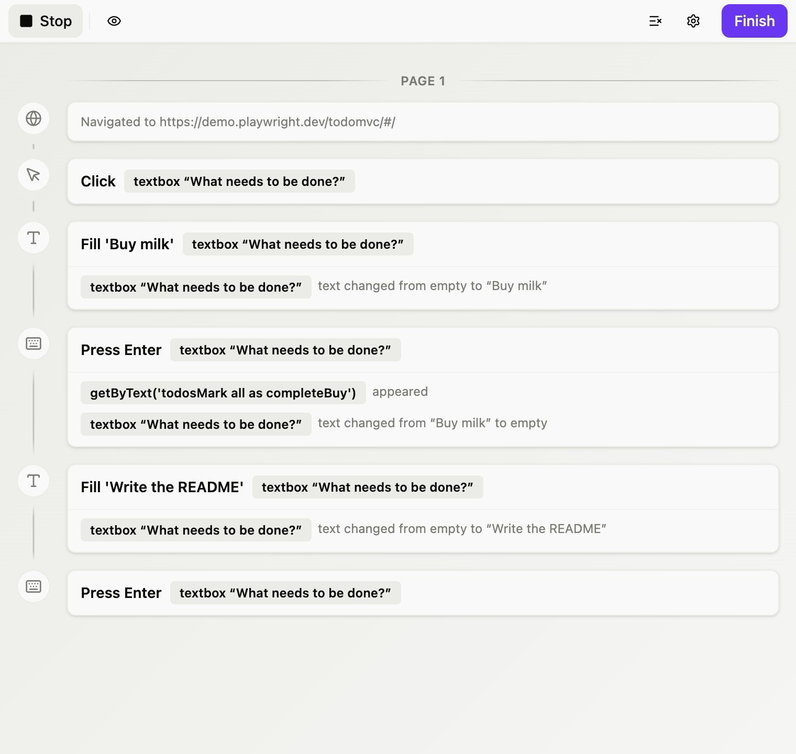
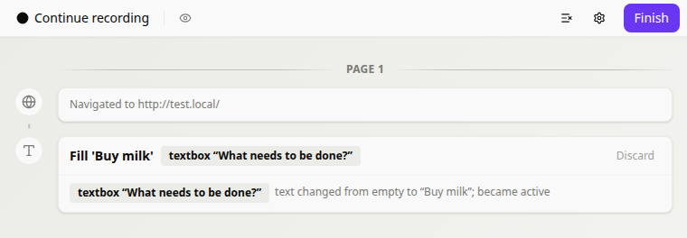
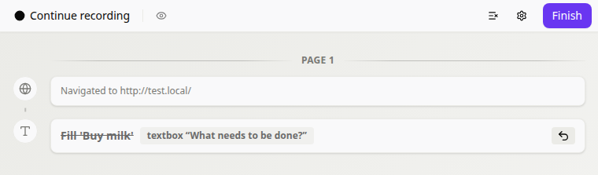

# Recorder

How to record a flow in your app with the ayme recorder and hand the recording to your coding agent.

The recorder is the `ayme-recorder` command in the npm package `@ayme-dev/cli`. You click through a flow in your app, and it saves each step and what that step changed on the page. Your coding agent then turns the recording into Playwright page objects and a test, with the [`ayme-recorder` skill](coding-agent-skill.md#ayme-recorder).

For a first recording, follow the [package's README](https://github.com/ayme-labs/ayme/blob/main/packages/cli/README.md), which has pictures. This page covers the commands, the controls, where recordings go, the warnings and the limits.

The commands are written `npx ayme-recorder`, for a project that has `@ayme-dev/cli` in its `package.json`. Without it, run `npx @ayme-dev/cli` in its place.

## Before you start

- Run every command in your project's folder. The recorder uses that project's Playwright and saves recordings there.
- The project needs `@playwright/test` (or `playwright`) installed, in a [supported version](#supported-playwright-versions). The recorder brings no Playwright and no browser of its own.
- Install Chromium once with `npx ayme-recorder install`. The recorder records in Chromium only.

### Supported Playwright versions

The recorder needs Playwright 1.62 or newer, and is verified on 1.62 to 1.65.

- **Older than 1.62:** the recorder does not start, and tells you the range.
- **Newer than 1.65:** it records, and warns that it may miss or misread an input.
- **No Playwright installed:** it does not start, and tells you how to install it.

## Hand a flow to your coding agent

With the `ayme-recorder` skill installed, ask your agent to record a flow and say where it starts:

> Record the checkout flow from http://localhost:3000 and write a Playwright test for it.

The agent starts the recorder at that address. Press **Record**, click through the flow, and press **Finish**. The agent reads the recording, proposes page objects and a test, and writes them once you agree.

You can also record first and hand the recording over afterwards. Run `codegen` yourself, then ask the agent to turn the recording into a test, and give it the path the terminal printed as `Recording package:`. Do not point it at `ayme/recordings/latest.yaml` instead: that file is a copy of the latest recording that was saved, so after a run that recorded nothing it still holds the one before.

## Commands

`npx ayme-recorder --help` lists every command and flag. `npx ayme-recorder --version` prints the installed version; it works only on its own, with no command or other flag.

### `codegen <url>`

Opens `<url>` in Chromium, with the recorder window beside it and a small toolbar on the page. Recording is off at first, so you can log in or get to your starting point. Press **Record** to start.

```sh
npx ayme-recorder codegen http://localhost:3000
```

The terminal prints the recorder window's address, such as `Recorder UI: http://127.0.0.1:52011/`. When the recording is saved, it prints `Recording package: <path>`. When there was nothing to save, it prints `Recording was empty; no recording package was created.`

- `--headless`: runs Chromium without a window. Open the printed `Recorder UI` address in a browser to control the recording.
- `--start-recording`: starts recording before the page loads, so the recording and its trace include the first page load and its network requests. The page opens blank and then goes to `<url>`. Wait for it to open before you do anything: what you do on the blank page is not recorded. After **Clear**, the next recording starts from the page as it is then.
- `--load-storage <file>`: opens the page with the cookies and local storage from `<file>`, a Playwright storage state file. You get such a file from `--save-storage` here, from `npx playwright codegen --save-storage`, or from your project's own login setup (`context.storageState()`). If the file cannot be read or holds no storage state, the recorder does not start.
- `--save-storage <file>`: when the recorder ends, saves the browser's cookies and local storage to `<file>`, as `npx playwright codegen --save-storage` does.
  - It saves at each [end of a recording](#end-a-recording). It saves even if nothing was recorded, or if the recording itself could not be saved.
  - It cannot save if you quit the whole browser.
  - To save a login without recording anything: log in, then close the page or press Ctrl+C. **Finish** is offered only after **Record**.
  - If the file cannot be saved, the recorder prints [a warning](#warnings).

### `codegen --cdp-endpoint <address>`

Records a Chromium that is already running, such as one you prepared by hand or one a script drives. Start that browser with its DevTools protocol open, for example with `--remote-debugging-port=9222`, and pass the address:

```sh
npx ayme-recorder codegen --cdp-endpoint http://127.0.0.1:9222
```

- The browser must run on this machine. The address is `http://` or `ws://`, on `localhost`, a `127.x.x.x` address or `[::1]`.
- The browser must have exactly one page open. The recorder records that page and does not navigate it.
- The recorder window does not open by itself. Open the printed `Recorder UI` address in any browser.
- What a script does in that browser is recorded like your own clicks and typing.
- The recorder ends and saves as [any recording does](#end-a-recording), then removes its toolbar from the page and leaves the browser open.
- `--headless`, `--start-recording`, `--load-storage` and `--save-storage` do not apply here, and you cannot pass a URL as well.

### `trace`

Opens a recording's trace with your project's own `npx playwright trace`:

```sh
npx ayme-recorder trace latest                    # the latest recording
npx ayme-recorder trace rec_20261113T195055354Z   # a recording by its id
npx ayme-recorder trace ayme/recordings/rec_20261113T195055354Z/trace.zip
```

`trace open` works the same way. Any other `trace` command, such as `trace actions` or `trace snapshot`, is passed to `npx playwright trace` as it is.

The trace is a standard Playwright trace, so `npx playwright trace` can open it directly too. It holds DOM snapshots and network requests, and no screenshots.

The trace's list of actions shows the recorder's own calls, not your steps. To find a step in the trace, use the position numbers the recording gives for it, as the [`ayme-recorder` skill](https://github.com/ayme-labs/ayme/blob/main/skills/ayme-recorder/SKILL.md#use-the-trace) describes.

### `install`

Installs Chromium with your project's own Playwright:

```sh
npx ayme-recorder install
```

Anything you add is passed to `npx playwright install` as it is, so name Chromium when you add a flag. For Chromium with its system dependencies:

```sh
npx ayme-recorder install chromium --with-deps
```

`install --with-deps` alone installs Playwright's default browsers, not only Chromium.

## Record a flow

The recorder window has every control. The toolbar on the page has two: the button that records, stops and continues, and **Assert visibility**. Both always show the same state, so use whichever is closer.



The pictures on this page are from an earlier version: the settings button beside **Finish** is gone.

- **Record** starts recording. Wait until the button reads **Stop** before your first step. What you do before that is not recorded.
- **Stop** pauses. While paused you can use the page freely: nothing you do is recorded, and neither is anything the page changes in the meantime. Wait until the button reads **Continue recording**. A click you make before that is still recorded.
- **Continue recording** resumes the same recording.
- **Assert visibility** records that an element must be visible. Press it, then click the element. An outline shows which element a click would pick, and the click does not reach your app. Press the button again to leave without picking.
- **Clear** throws away everything recorded so far, so you can start over.
- **Finish** saves the recording, including your last step. You do not need to press **Stop** first.

After **Stop**, **Clear** or **Finish**, the recorder may need a moment to finish the step in progress. Until it has, the window shows a status that starts with **Wrapping up**, the toolbar shows a spinner, and the buttons wait.

### What the window shows

The window lists what you record as you go.



- **Pages.** A heading with the page's address starts each Visit. A Visit starts when you press **Record**, when a new tab or window opens, and when a page goes to another site or another path. A reload, or a change of only the address's query or hash, stays in the same Visit.
- **Steps.** Each click, typed text, key press, dropdown choice and upload, with the element it acted on. Typed text shows while you type.
- **Changes.** Under each step, what it changed on the page: the elements that appeared, were removed or changed, with the old and new value of a changed one. They can show a moment after the step. A change of only the text cursor is not listed.
- **Changes without a step.** Something that changed without you doing anything, such as a banner that loaded late, shows as a row of its own.

Elements are named by their role and name, such as `button "Save"`, with more words when that alone would fit other elements on the page too.

When many elements of one role appear in or are removed from the same named element, such as the items of a list, they show as one row: `30 listitems`, with `25 removed from, 5 appeared in "Issues"`. Expand the row to see each of them.

Hover an element in the window to highlight it on the page. Hovering the element of a step also shows its Playwright locator, such as `getByRole('button', { name: 'Save' })`. If you have left that page, or the element is gone, the highlight shows everything on the current page that matches, so it can land on a look-alike.

### Leave steps out

To leave a step out of the recording, hover it and press **Discard**. You can do this at any time between **Record** and **Finish**, without pressing **Stop** first. A change without a step can be discarded the same way.





- A discarded step stays in the list, struck through, with its changes hidden. Its undo icon, **Restore**, brings it back.
- Discarding does not undo anything on the page. What you do next is recorded from the page as it is.
- Discarding does not remove the step from the trace, so it does not hide something you typed by mistake. The saved recording keeps a stub of the step that tells the agent to leave it out.
- Your discards survive **Stop** and **Continue recording**. **Clear** drops them with everything else.

## End a recording

Each of these ends the recorder and saves what was recorded:

- press **Finish**,
- close the last recorded page,
- press Ctrl+C in the terminal,
- close the terminal, or lose the SSH session it runs in.

After an error that nothing in the recorder caught while a recording runs, the recorder tries to save what it has, prints the error and exits with code 1.

If you never pressed **Record**, there is nothing to save.

Do not end by quitting the whole browser. The recorder ends then too, but the recording can be saved without its trace, and `--save-storage` cannot save.

The recorder always ends, even when the browser stops answering. It waits a few seconds, leaves out the steps that were not complete, and saves the rest. If the trace cannot be written either, it saves the recording without its trace after a minute.

## Record a logged-in app

The recorder does not keep you logged in between recordings. Unless you use the storage flags, each `codegen <url>` opens a browser with no cookies and no local storage, and keeps nothing when it ends. To record an app that needs a login, do one of these:

- **Log in before you press Record.** Recording is off at first, so the login is not recorded.
- **Load a saved login** with `--load-storage <file>`. You get the file from `--save-storage <file>` (log in, then close the page or press Ctrl+C), from `npx playwright codegen --save-storage <file>`, or from your project's own login setup.
- **Record a browser that is already logged in**, with `codegen --cdp-endpoint <address>`.

## Where recordings are stored

Recordings go in your project's [`ayme` folder](ayme-folder.md), beside `package.json`:

```text
ayme/
  .gitignore                     keeps recordings out of git
  recordings/
    latest.yaml                  a copy of the latest package that was saved
    rec_<time>/
      package.yaml               the pages, the steps and what each changed
      trace.zip                  the Playwright trace of the recording
```

`package.yaml` is the file your agent reads. The [`ayme-recorder` skill](https://github.com/ayme-labs/ayme/blob/main/skills/ayme-recorder/SKILL.md#read-the-package) describes every field.

The first save creates `ayme/.gitignore`, which lists `recordings/` and itself. If the folder already has one, such as the one `ayme mcp` writes, a save adds a `recordings/` line at its end. It leaves the file as it is when a line there already names the folder, such as `!recordings/` to commit recordings, and when it cannot write to the file; the recording is saved either way. A `recordings/` line keeps new recordings out of git. It cannot untrack recordings you have already committed.

## Warnings

A warning is a line in the terminal that starts with `Warning:`. The recording goes on. Most warnings come while the recorder runs; some come as it ends.

A warning about one step names it by its id in the recording, such as `interaction_4`, because the recording does not mark the step. A warning about a change the page made by itself names it by its time and the step before it. If you ran `codegen` yourself, pass such a warning on to your agent with the recording, so that it checks that part against the trace.

- **Playwright is newer than the recorder is verified on.** It may miss or misread an input. See [Supported Playwright versions](#supported-playwright-versions).
- **A step is recorded, but its list of changes may be incomplete.** Playwright reported the input in a form the recorder does not read, or the page could not be read at that moment.
- **The page could not be read before or after a step.** The step is recorded with what Playwright reported of it. With no read after it, it lists no changes; typing lists those up to its last read that worked. With no read before it, it also names its element by its selector only. No other step lists what the missing read would have shown.
- **The page could not be read where a step picked its element.** An assertion then names its element by its selector only.
- **The page a step led to could not be read at first.** The step is recorded as ever. What that page showed right then is not in the recording.
- **A read of the page could not be kept.** No step starts or ends at that read. If the page changed by itself around it, the recording does not list that change. The warning gives the time of the read, and its position in the trace when the recording has position numbers. When recording resumed at that read after a pause, the page may have loaded again, so the recording names its elements anew from the next read on.
- **The page could not be read where a Visit starts in the recording.** The Visit's first picture, its `baselineTree`, is empty.
- **A step's changes could not be fully worked out.** The step is recorded with its changes, but an element the page re-created may be under another ref in them, or listed as removed and added. The same can happen to a change the page made by itself, and to a Visit's `baselineTree`.
- **A step's changes cannot be listed in the recorder window.** The window shows the step without them. The recording has them.
- **A step has no list of changes.** The recorder could not work out what the step changed. The step is recorded with its type, its selector and what you entered. If the recording has a trace and position numbers for the step, the trace holds the page before and after it.
- **Whether the page changed by itself could not be worked out.** The recording lists no such change at the time the warning gives.
- **A step is not recorded.** Its page could not be read. This can happen to typing, a dropdown choice, an upload or an assertion.
- **Inputs on a page are not recorded.** The page replaced `JSON.stringify`, or changed how it writes an object, as Prototype.js 1.6 does for arrays, and Playwright reports every input through it. The warning names the page or frame, and comes with the first input the recorder leaves to it. Your clicks and keys still reach it, but those given while its calls are lost are not recorded. The toolbar may not answer on that page: stop and finish in the recorder window, at the address the recorder printed.
- **A step, or something else, is missing from the recording.** The recorder itself failed to keep it. The warning names the step when a step is missing, and ends with the recorder's own error. The trace still holds what happened on the page.
- **A step is in the recording without its element, or only as Playwright reported it.** The recorder could not read Playwright's report of the step in full. Without its element, the step has its type, what Playwright said of the input, such as a click's button, and the page's changes. As Playwright reported it, the step names the element Playwright named, which can be one inside the element it acted on, and an upload is typing of the path the browser shows for it, `C:\fakepath\` and the first file's name. The warning ends with the recorder's own error.
- **Typing may be missing its latest keys.** The recorder could not read Playwright's revision of the typing. The trace still holds the keys.
- **An upload is recorded with its first file name only.** The file input was gone, or held other files than Playwright reported, by the time the recorder read it.
- **Some or all of the trace's snapshots could not be numbered.** The recording has its trace, but lacks the position numbers that open those steps' snapshots.
- **The storage state could not be saved.** `--save-storage` could not write its file, the browser was quit or did not answer within half a minute, or the recorder broke down while saving. The recording ends as it would have without the save.

If the recorder cannot start, it prints the reason in one sentence and exits with code 1. It does not start when:

- no Playwright is installed, it is too old, or that version has no Playwright recorder,
- Chromium could not be opened or reached,
- the `--cdp-endpoint` address is not on this machine, or the running browser has no page or more than one,
- the `--load-storage` file cannot be read or holds no storage state,
- the recorder window could not be served.

## Limits

- **The trace keeps running while paused.** It runs from the first **Record** to **Finish**, so what is on the page while paused, including what you type, can show in it. Do not type a secret while paused and expect it to be left out.
- **Closing the page right after your last click can lose that click.** End with **Finish** instead, which saves your last step. After such a close, the recorder can also take about five seconds to end.
- **A double click can reach the page as a single click.** It depends on timing, and a slow page or a busy machine makes it more likely.
- **Pasted text, and text from an input method that composes it, may not reach the page exactly as you gave it.** This affects the first thing you type after **Record**, and what you type while an earlier step is still being recorded. The recorder holds those keys back for a moment and sends them again.
- **In a form that moves the focus by itself, a change can be listed under the step before.** In a verification code with one box per character, for example, typing into the next box before the page is quiet can list that change under the box before. The same can happen when you type right after a dropdown choice or an upload.
- **A press that opens a list or a menu under the pointer can be recorded without what it opened.** Some selects and menus open on the press, and the list comes up under the pointer. The recorder cannot hold that click back without closing the list, so it lets it through. As the first step on a page, right after typing, or when you press while the step before is still being recorded, it reads the page only after the click: what opened is then part of the page before the step, or listed under the step before, and a change of focus can be listed under the wrong one of the two steps. If such a first step leads to another page, it can be listed on that page.
- **The toolbar on the page cannot be pressed while a `<dialog>` is open as a modal.** The dialog makes the rest of the page inert, the toolbar included, and a press there can close the dialog. Pressing **Assert visibility** on the toolbar also closes a `popover="auto"` that is inside a shadow root, and, on a browser the recorder attached to, a nested popover that was already open when it attached and comes earlier in the page than the popover it opened from. Press **Assert visibility** in the recorder window instead: the dialog or popover stays open, and you can pick an element inside it. A popover in the page's own document stays open, and dialogs, popovers and menus that a UI library draws from ordinary elements are not affected.
- **Cross-origin iframes and transformed iframes were not tested.** Same-origin iframes and open shadow roots are.
- **Very large pages make the recorder lag.** It reads the page at each click and at the first key you type after **Record** or on a new page. That takes 10 to 40 ms on an ordinary page, and about a second on a page with tens of thousands of elements, such as the Wikipedia article "World War II". The recorder window lags with it.
