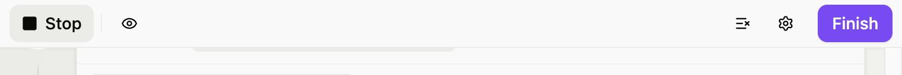
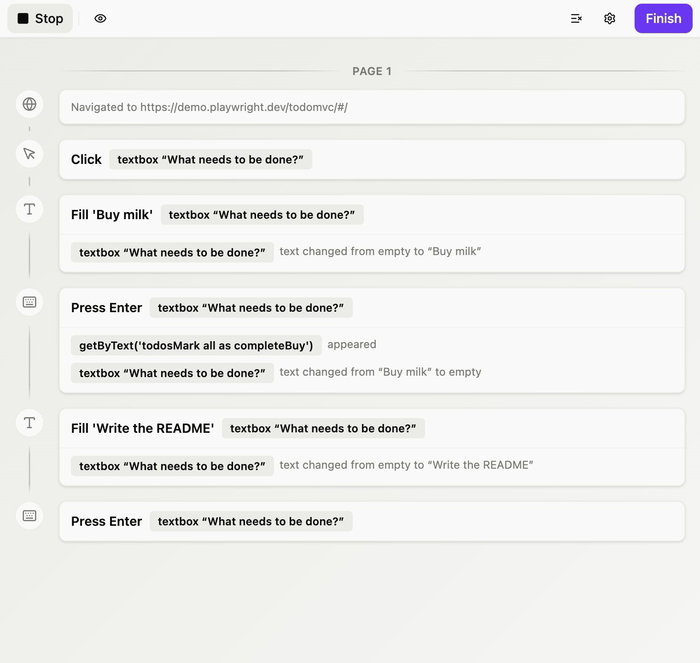
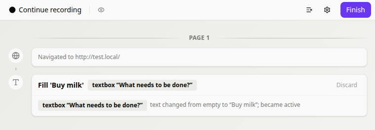
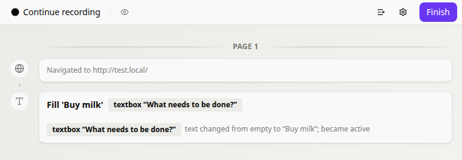

# ayme

`ayme` is the command of `@ayme-dev/cli`. It holds two products:

- **ayme inspect**: your coding agent calls your project's Page Object Tools beside the browser automation it already uses, and you watch and run them in the Inspector.
- **ayme capture**: you click through a flow in your app, it records every step and what each step changed, and your coding agent turns the recording into Playwright page objects and a test.

The [ayme documentation](https://github.com/ayme-labs/ayme/blob/main/docs/guide/README.md) has the detail. Coming from 0.3, read [Upgrade](https://github.com/ayme-labs/ayme/blob/main/docs/guide/upgrade.md) first.

## Install

From your project's folder:

```sh
npm install -D @ayme-dev/cli "@playwright/test@>=1.62 <1.65"
npx playwright install chromium
```

ayme runs on your project's own Playwright and brings no browser. Run it as `npx ayme`, from your project's folder. [Connect an agent](https://github.com/ayme-labs/ayme/blob/main/docs/guide/guides/connect-an-agent.md#set-up-your-project) has the rest of the setup for Page Objects, and [ayme capture](https://github.com/ayme-labs/ayme/blob/main/docs/guide/guides/recorder.md#before-you-start) the Playwright versions it records on.

Install the skills that teach your coding agent each product, as [Coding agent skills](https://github.com/ayme-labs/ayme/blob/main/docs/guide/guides/coding-agent-skill.md) describes:

```sh
npx skills add ayme-labs/ayme --skill ayme
npx skills add ayme-labs/ayme --skill ayme-capture
```

To update, install `@ayme-dev/cli@latest`, with `@ayme-dev/ayme` at the same version if your project has it, and run the two `npx skills add` lines again. `npx ayme --version` prints the version you have.

## Page Objects for your coding agent

Your coding agent starts a Session: one running ayme connected to the browser its browser automation drives, such as Playwright CLI, Playwright MCP or agent-browser. The Session runs the Page Objects your project lists in `ayme/page-objects.ts`, in Node, on your project's Playwright. Nothing of ayme has to be in your app.

```sh
npx ayme open http://localhost:5173/
npx ayme page-objects
npx ayme call ProjectRow.rename --params '{"id": "po1", "args": {"name": "Launch plan v2"}}'
npx ayme close
```

`ayme open` starts Chromium and prints the address the browser automation attaches to; `ayme attach --cdp=<url>` joins a browser the automation opened instead. `ayme page-objects` prints the Page Objects on the screen, with the id of each one that has a root, `ayme call` runs one of their tools, and `ayme close` ends the Session. [Connect an agent](https://github.com/ayme-labs/ayme/blob/main/docs/guide/guides/connect-an-agent.md) shows each browser automation, and `npx ayme --help` lists every command.

## The Inspector

`npx ayme inspect` opens the Inspector on a Session in your default browser: the Page Objects and tools of the Session's Tab, to run by hand. Registered in your Agent App's MCP configuration, `ayme mcp` shows the same Inspector in the chat. See [Inspector](https://github.com/ayme-labs/ayme/blob/main/docs/guide/guides/inspector.md#in-a-window-of-its-own).

## ayme capture


The [ayme capture guide](https://github.com/ayme-labs/ayme/blob/main/docs/guide/guides/recorder.md) has every command and flag, the warnings and the limits. The sections below walk you from a recording to a written test.

### Record a flow

Run ayme capture from your project's folder and pass the address where the flow starts:

```sh
npx ayme capture http://localhost:3000
```

It opens the page in Chromium, with the Recorder beside it and a small toolbar on the page. The terminal prints the window's address as `Recorder UI: ...`.

Recording is off when the Recorder opens, so you can first get the page into the state you want to start from, for example by logging in. The Recorder keeps no login between recordings; the guide shows [three ways to record a logged-in app](https://github.com/ayme-labs/ayme/blob/main/docs/guide/guides/recorder.md#record-a-logged-in-app). Then:

1. Press **Record** in the Recorder, or on the toolbar.
2. Walk through the flow in the app.
3. Press **Finish** to save the recording.



While recording, **Record** turns into **Stop**: press it to pause, and **Continue recording** to pick up again. The guide describes [every control](https://github.com/ayme-labs/ayme/blob/main/docs/guide/guides/recorder.md#record-a-flow).

**Finish**, closing the last recorded page and Ctrl+C in the terminal each save the recording. The terminal then prints its path as `Recording package: ...`. If nothing was recorded, it prints `Recording was empty; no recording package was created.` instead.

#### What the Recorder shows



The Recorder lists the flow as you go:

- **Visits**: a heading such as **PAGE 1**, with its address, starts each Visit: the page you pressed **Record** on, a page that went to another path, or a new tab.
- **Steps**: each click, typed text, key press, choice or upload, with the element it acted on.
- **Changes**: under each step, what changed on the page as a result, for example an element that appeared or was removed, or text that changed.

Hover an element in the window to highlight it on the page. The guide says more about [what the window shows](https://github.com/ayme-labs/ayme/blob/main/docs/guide/guides/recorder.md#what-the-window-shows).

#### Discard and restore a step

To leave a step out, hover it and press **Discard**. You can do this while recording, without pressing **Stop**, for a step, a visibility assertion or a change no step explains.



The step stays in the timeline, struck through, with its changes hidden. An undo icon puts it back.


Press the undo icon to restore the step, with its changes.



Discarding a step does not put the page back: what you do next is recorded from the page as it is. **Finish** saves a discarded step as a stub that tells your agent to leave it out, and **Clear** forgets your choices. The trace still holds the discarded step, so Discard does not hide something you typed by mistake.

#### Assert what matters

Your agent writes the test's checks from what the recording saw change, but some things are easy to miss. To make sure the test checks that something is visible, press **Assert visibility** (the eye button) while recording, then click that element in the app. The click does not reach your app; the Recorder records it as a visibility assertion. Press the eye button again for each element you want to assert.

### What the Recorder writes

The Recorder keeps its data in an `ayme` folder in the folder you run it from:

- `ayme/recordings/<recording-id>/package.yaml`: the package's YAML file: the page at each Visit, the steps and the changes.
- `ayme/recordings/<recording-id>/trace.zip`: the Playwright trace of the recording, with DOM snapshots and network requests. When the trace cannot be written, for example because the browser stopped answering, the recording is saved without it.
- `ayme/recordings/latest.yaml`: a copy of the latest recording that was saved. A run that recorded nothing leaves it as it was, so use the path printed as `Recording package:` for the run you just made.

The first save lists `recordings/` in `ayme/.gitignore`, and creates the file if the folder has none. That keeps new recordings out of what git picks up, but it cannot untrack files that are already committed. The guide says [when the Recorder leaves the file as it is](https://github.com/ayme-labs/ayme/blob/main/docs/guide/guides/recorder.md#where-recordings-are-stored). To look into a trace, open it with `npx playwright trace open ayme/recordings/<recording-id>/trace.zip`; the guide explains [what the trace holds](https://github.com/ayme-labs/ayme/blob/main/docs/guide/guides/recorder.md#trace).

### Turn a recording into page objects

The `ayme-capture` skill teaches your coding agent to read a recording and write page objects and a Playwright test from it. Install it as in [Install](#install), or copy this request into your coding agent:

> Install the `ayme-capture` skill from https://github.com/ayme-labs/ayme/tree/main/skills/ayme-capture into this project's skill directory, including its references, playbooks and assets.

Then hand it the recording you just saved, with the path the terminal printed as `Recording package:`:

> Turn the recording at `ayme/recordings/<recording-id>/package.yaml` into Playwright page objects and a test, with the `ayme-capture` skill.

The agent reads the recording, proposes the page objects and the test, and writes them once you agree. You can also ask the agent to record the flow itself, as the guide describes in [Hand a flow to your coding agent](https://github.com/ayme-labs/ayme/blob/main/docs/guide/guides/recorder.md#hand-a-flow-to-your-coding-agent).

### Compared with Playwright MCP

A coding agent wrote Playwright page objects and a passing test for the same flow in two ways:

- **ayme capture:** the flow was recorded once, and the agent worked from the recording with the Recorder's skill. The recording was made by a script that gave the steps as input events, not by a person.
- **Playwright MCP:** the agent got the flow as written steps and explored the pages itself.

|                | Time to a passing test | Mean | Runs with a failed test run | Cost                  |
| -------------- | ---------------------- | ---- | --------------------------- | --------------------- |
| ayme capture   | 47 s (44 – 56)         | 49 s | 0 of 5                      | $0.39 ($0.35 – $0.43) |
| Playwright MCP | 91 s (52 – 147)        | 91 s | 2 of 5                      | $0.41 ($0.33 – $0.46) |

Time and cost show the median of five runs, with the lowest and highest in parentheses. Every run ended with a passing test. The time ranges overlap by one run.

A failed test run is a run of the test that failed before its first pass; a command that started no test does not count. In one Recorder run, the test failed twice after that first pass, on a locator that matched two links, and the agent fixed it before the run ended. When each of the ten tests was run three more times afterwards, all ten passed 3 of 3.

The flow has nine steps on a GitHub repository page: through its pull requests, its releases and the Code menu.

**How it was measured**

- **When and where:** once, on 2026-11-23, on a Mac against live github.com. The runs went one at a time, the two sides alternating.
- **Agent:** Claude Code on Sonnet 5.5 (`claude-sonnet-5-5`) at medium effort.
- **Recorder:** `@ayme-dev/cli` built from commit [`acaa6d1f3`](https://github.com/ayme-labs/ayme/commit/acaa6d1f39d51686ca9269f9fd5b788b3ec5e400), with the `ayme-recorder` skill of the same commit, since renamed `ayme-capture`.
- **Time:** the agent's working time from the prompt to the first passing run of the test it wrote, without the wait for the one reply each run got to its plan.

The [measurement's write-up](https://github.com/ayme-labs/ayme/issues/1358#issuecomment-7098192006) has each run and the full method.

## License

[MIT](https://github.com/ayme-labs/ayme/blob/main/packages/cli/LICENSE), for all of ayme's code in this package, including the code it bundles from other ayme packages. Bundled third-party code keeps its original license; see `dist/THIRD_PARTY_NOTICES.txt` and, for the Inspector, `dist/inspector/THIRD_PARTY_NOTICES.txt` in the package. The ayme name and logos are not covered by the license; see [TRADEMARKS.md](https://github.com/ayme-labs/ayme/blob/main/packages/design-system/TRADEMARKS.md).
