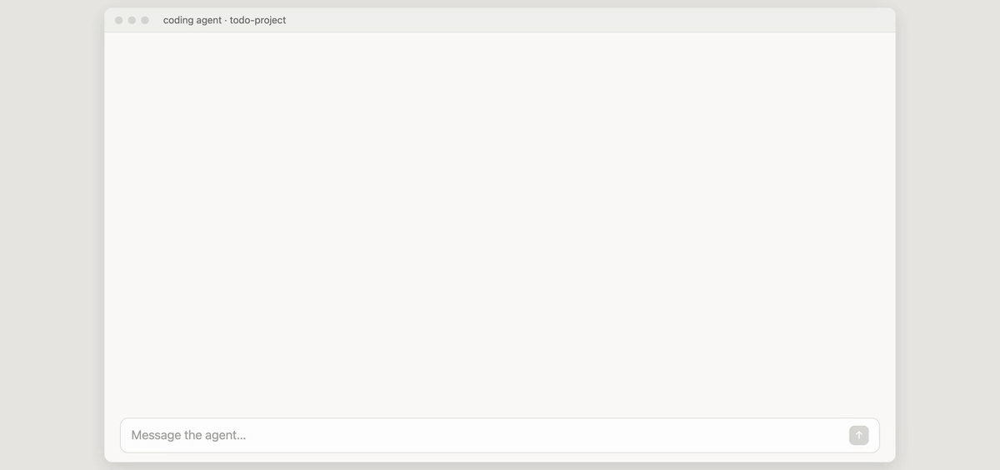
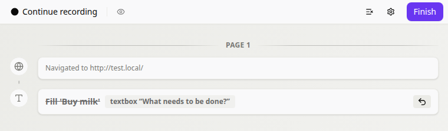

# ayme recorder

The ayme recorder records a flow you click through in your app: every page you visit, every step, and what each step changed on the page. It saves the recording, with its Playwright trace, in your project. Your coding agent then turns the recording into Playwright page objects and a test.



The [Recorder guide](https://github.com/ayme-labs/ayme/blob/main/docs/guide/guides/recorder.md) has every command and flag, the warnings and the limits. This page walks you from installing it to a written test.

## Install

The recorder runs on the Playwright your project already has. It brings no Playwright and no browser of its own, so your project needs `@playwright/test` (or `playwright`) installed, 1.62 or newer. The guide lists [the supported versions](https://github.com/ayme-labs/ayme/blob/main/docs/guide/guides/recorder.md#supported-playwright-versions).

Add the recorder to your project as a dev dependency:

```sh
npm install -D @ayme-dev/cli
```

This gives you the `ayme-recorder` command; run it with `npx ayme-recorder`, from your project's folder. You can also install it globally with `npm install -g @ayme-dev/cli` and run `ayme-recorder`, or run it without installing as `npx @ayme-dev/cli`. Either way, run it in your project's folder: that is where it looks for Playwright and saves recordings.

Recording needs Chromium for your project's Playwright. Install it once with:

```sh
npx ayme-recorder install
```

To let your coding agent turn recordings into page objects, install the `ayme-recorder` skill in your project:

```sh
npx skills add ayme-labs/ayme --skill ayme-recorder
```

### Updating

- **Project dependency:** `npm install -D @ayme-dev/cli@latest`. `npx ayme-recorder` runs the version your project pins, so it stays on that version until you update it.
- **Global install:** `npm install -g @ayme-dev/cli@latest`.
- **Without installing:** `npx @ayme-dev/cli@latest codegen <url>`. Plain `npx @ayme-dev/cli` can reuse a copy it downloaded earlier.
- **The skill:** run `npx skills add ayme-labs/ayme --skill ayme-recorder` again.

To see which version you have, run `npx ayme-recorder --version`.

## Record a flow

Run the recorder from your project's folder and pass the address where the flow starts:

```sh
npx ayme-recorder codegen http://localhost:3000
```

It opens the page in Chromium, with the recorder window beside it and a small toolbar on the page. The terminal prints the window's address as `Recorder UI: ...`.

Recording is off when the recorder opens, so you can first get the page into the state you want to start from, for example by logging in. The recorder keeps no login between recordings; the guide shows [three ways to record a logged-in app](https://github.com/ayme-labs/ayme/blob/main/docs/guide/guides/recorder.md#record-a-logged-in-app). Then:

1. Press **Record** in the recorder window, or on the toolbar.
2. Walk through the flow in the app.
3. Press **Finish** to save the recording.


While recording, **Record** turns into **Stop**. Press it to pause, and **Continue recording** to pick up again. **Clear** throws away everything recorded so far. The toolbar on the page has the button that records, stops and continues, and **Assert visibility**. The guide describes [each control](https://github.com/ayme-labs/ayme/blob/main/docs/guide/guides/recorder.md#record-a-flow).

To end, press **Finish**, close the browser, or press Ctrl+C in the terminal: each saves what was recorded. The terminal then prints the path of the recording as `Recording package: ...`.

### What the recorder shows


The recorder window lists the flow as you go:

- **Visits**: a heading such as **PAGE 1**, with the address the page went to, starts each page load.
- **Steps**: each click, typed text, key press, choice or upload, with the element it acted on.
- **Changes**: under each step, what changed on the page as a result, for example an element that appeared or was removed, or text that changed.

Hover an element in the window to highlight it on the page. The guide says more about [what the window shows](https://github.com/ayme-labs/ayme/blob/main/docs/guide/guides/recorder.md#what-the-window-shows).

### Discard and restore a step

To leave a step out, hover it and press **Discard**. You can do this while recording, without pressing **Stop**, for a step, a visibility assertion or a change no step explains.


The step stays in the timeline, struck through, with its changes hidden. An undo icon puts it back.



Press the undo icon to restore the step, with its changes.


Discarding a step does not put the page back: what you do next is recorded from the page as it is. **Finish** saves a discarded step as a stub that tells your agent to leave it out, and **Clear** forgets your choices.

### Assert what matters

Your agent writes the test's checks from what the recording saw change, but some things are easy to miss. To make sure the test checks that something is visible, press **Assert visibility** (the eye button) while recording, then click that element in the app. The click does not reach your app; the recorder records it as a visibility assertion. Press the eye button again for each element you want to assert.

## What the recorder writes

The recorder keeps its data in an `.ayme` folder in the folder you run it from:

- `.ayme/recordings/<recording-id>/package.yaml`: the recording: the page at each Visit, the steps and the changes.
- `.ayme/recordings/<recording-id>/trace.zip`: the Playwright trace of the recording, with DOM snapshots and network requests.
- `.ayme/recordings/latest.yaml`: a copy of the most recent recording.

The first save creates `.ayme/.gitignore`, so none of this is committed. To look into a trace, run `npx ayme-recorder trace latest`; the guide explains [what the trace holds](https://github.com/ayme-labs/ayme/blob/main/docs/guide/guides/recorder.md#trace).

## Turn a recording into page objects

The `ayme-recorder` skill teaches your coding agent to read a recording and write page objects and a Playwright test from it. Install it as in [Install](#install), or copy this request into your coding agent:

> Install the `ayme-recorder` skill from https://github.com/ayme-labs/ayme/tree/main/skills/ayme-recorder into this project's skill directory, including its references, playbooks and assets.

Then ask the agent to record a flow. It starts the recorder; you walk through the flow and press **Finish**. The agent reads the recording, proposes the page objects and the test, and writes them once you agree.

## Compared with Playwright MCP

A coding agent wrote Playwright page objects and a passing test for the same flow in two ways:

- **ayme recorder:** the flow was recorded once, and the agent worked from the recording with the `ayme-recorder` skill. The recording was made by a script that gave the nine steps as input events, not by a person.
- **Playwright MCP:** the agent got the flow as written steps and explored the pages itself.

|                | Time to a passing test | Mean | Runs with a failed test run | Cost                  |
| -------------- | ---------------------- | ---- | --------------------------- | --------------------- |
| ayme recorder  | 47 s (44 – 56)         | 49 s | 0 of 5                      | $0.39 ($0.35 – $0.43) |
| Playwright MCP | 91 s (52 – 147)        | 91 s | 2 of 5                      | $0.41 ($0.33 – $0.46) |

Time and cost show the median of five runs, with the lowest and highest in parentheses. Every run ended with a passing test. The time ranges overlap by one run.

A failed test run is counted up to the test's first pass. In one recorder run, the test failed twice after that first pass, on a locator that matched two links, and the agent fixed it before the run ended. When each of the ten tests was run three more times afterwards, all ten passed 3 of 3.

**The flow**, on [github.com/ayme-labs/ayme](https://github.com/ayme-labs/ayme), not logged in:

1. Open the "Pull requests" tab.
2. Check that one pull request is listed.
3. Go back to the repository page.
4. Open the releases.
5. Check that one release is listed.
6. Go back to the repository page.
7. Open the "Code" menu.
8. Switch to the "GitHub CLI" tab.
9. Follow the "Which remote URL should I use?" link.

**How it was measured**

- **When and where:** once, on 2026-11-23, on a Mac against live github.com. Five runs a side, one at a time, the two sides alternating.
- **Agent:** Claude Code on Sonnet 5.5 (`claude-sonnet-5-5`) at medium effort, with one thread and one fresh folder per run.
- **Recorder:** `@ayme-dev/cli` built from commit [`acaa6d1f3`](https://github.com/ayme-labs/ayme/commit/acaa6d1f39d51686ca9269f9fd5b788b3ec5e400), with the `ayme-recorder` skill of the same commit.
- **Versions:** Playwright Test 1.65.1, and Playwright MCP as `@playwright/mcp@latest`, run headless.
- **Time:** the agent's working time from the prompt to the first passing run of the test it wrote. The recording was made before the runs and is not counted, and neither is the wait for the one-line approval each agent got for its plan.
- **Failed test run:** a run of the test that failed, which the agent then fixed.
- **Cost:** each run's token usage at $2 per million input tokens, $10 per million output tokens, $0.10 per million cache reads and $4 per million one-hour cache writes.

The [measurement's write-up](https://github.com/ayme-labs/ayme/issues/1358#issuecomment-7098192006) has each run and the full method.

## License

[FSL-1.1-ALv2](https://github.com/ayme-labs/ayme/blob/main/packages/cli/LICENSE). Bundled third-party code keeps its original license; see `dist/THIRD_PARTY_NOTICES.txt` in the package.
