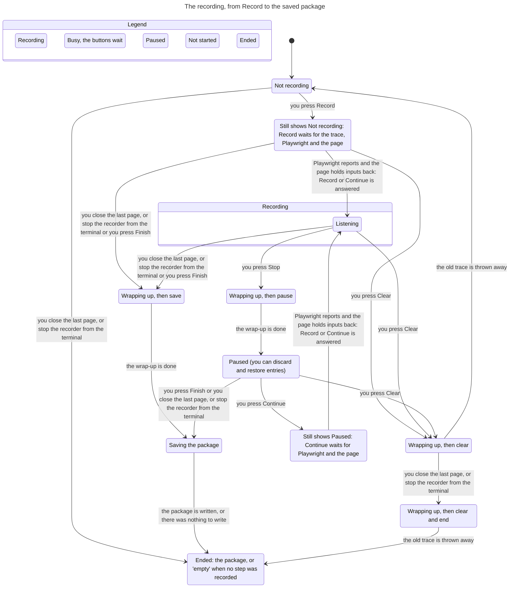
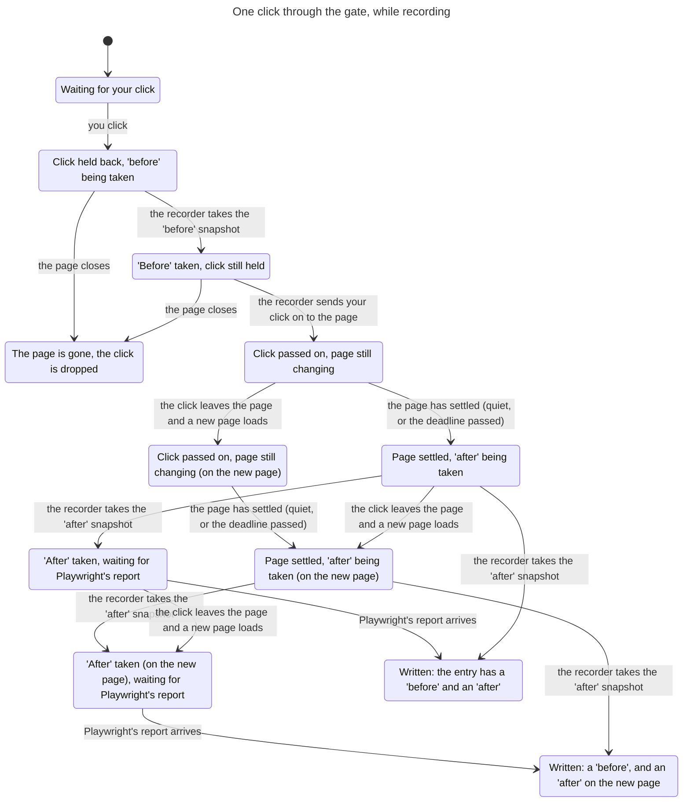
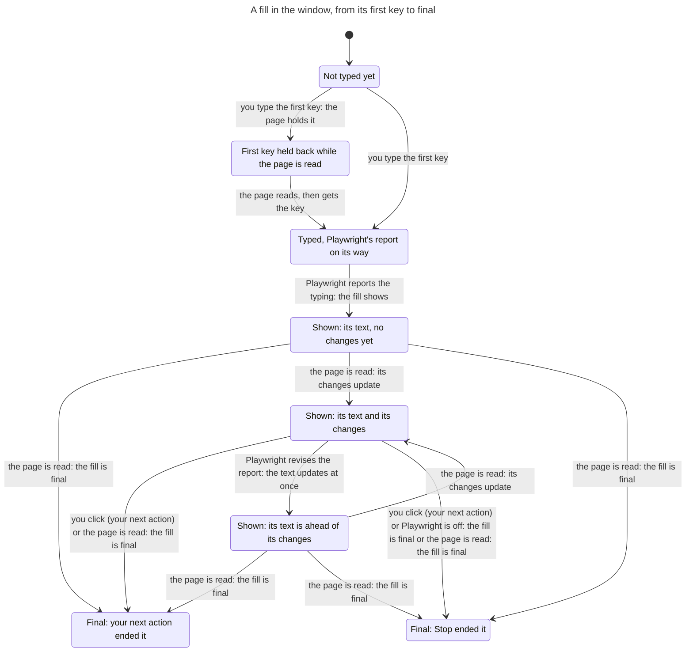

# Recorder lifecycle model

A model of the Recorder's lifecycle in TLA+, checked with the TLC model checker against the rules the Recorder must keep ([#1267 "Recorder rebuild"](https://github.com/ayme-labs/ayme/issues/1267), "Rules the recorder must keep"). It covers what the engine does from Record to the saved Recording Package: the gate that holds inputs back, Playwright's reports, the reads of the page, the wrap-up after Stop, Finish, Clear or Ctrl+C, and typed text shown in the window while it is typed.

A test checks the orders someone thought to write. The model checks every order of these steps within its bounds, and gives the shortest sequence of steps to each rule that breaks.

**Last compared with the engine at commit `b2af1120`.**

## Words

- **The engine**: `packages/recorder/src/`. Short names in this README and in `Recorder.tla`: **L** `session/domain/lifecycle.ts` (the lifecycle, one pure function), **SB** `playwright/infrastructure/live/stockBrowser.ts` (the Playwright adapter), **G** `playwright/infrastructure/in-page/gate.ts` (the gate in each document), **PR** `playwright/infrastructure/pageRules.ts`, **RS** `session/application/recorderSession.ts` (the one worker), **TB** `server/infrastructure/toolbarBridge.ts`, **WC** `server/infrastructure/windowChannelRouter.ts`, **TL** `timeline/domain/timeline.ts`.
- **The gate**: the recorder's script in each document of the page. While it is on, it holds a click or key back until the recorder has read the page, then sends it on.
- **A read**: the recorder reading the whole page once (a snapshot). An Interaction's **"before"** and **"after"** are reads.
- **Settle**: after an input, the recorder waits for the page to be quiet for 250 ms, or 2 s at most, before it reads the "after" (`packages/core/src/observation/waitForSettled.ts`). Each key typed while it waits starts the 250 ms of quiet again, as the page's activity watch hears each `input` event; the 2-second deadline runs from the wait's start and does not restart.
- **The wrap-up**: what the engine does between Stop, Finish, Clear or Ctrl+C and the state they lead to.
- **Start recording**: `codegen <url> --start-recording`. The page opens blank, the recorder applies Record as soon as it starts (`startRecorder`), and the page goes to its address once the pages hold inputs back, Record's last step (SB `opening`, `holdInputs`). The blank page has no Visit (L `atRecord`, "blankAtRecord"); its first address while recording starts the first Visit, "initial" (L `pageNavigated`).
- **A report**: Playwright's message that an input happened; it carries Playwright's **picture**, its own view of the page at that moment. A **revision** is Playwright revising its last report of typing with the field's new text.
- **Clicks**: a left click, a right-click and a middle click are steps; the gate holds each, a right-click by its context menu event and a middle click by its auxclick. A click's report goes only to a held click of its button. Playwright reports a left or a middle click on a checkbox or a radio as a check or an uncheck, which names no button: that report goes to the oldest held left or middle click, never a right click, and a middle click is saved with it as the middle click it was (L `reportOfHeld`, `reportsClickOf`, `asHeld`).
- **A fill**: typed or pasted text in one field, as Playwright reports it. A choice in a dropdown and a file upload act the same, with no more keys. A **live fill** is one the window shows that can still change.
- **A row**: one line of the recorder window. The **rows under** a fill are what it changed. Its **"changed before" row**, above it, is what changed between its start and Playwright's picture at its first key.
- **Quick**: the model's speed assumption. Switching the gate and Playwright's mode, telling the open pages that picking ended, the page's message that it holds a click, Playwright's report of an assertion, of typing, of a right-click or of a middle click, a click report another input made Playwright send, a wrap-up's last read, and switching Playwright off while it holds no click report all finish before the person's next action. "At a person's speed" means with Quick; a **race** is a path that needs Quick off.

## Using it

The project skill `verify-recorder-lifecycle` (in `.agents/skills/`) says when to run the model and how to read and update it. In short: when a change to the engine alters the order of events, what the recorder waits for, or a promise it makes, run the model, bring it in line with the change, and read every rule that breaks as a sequence of steps.

Read every result with the `statechart` skill: it shows each rule that breaks as its shortest path in plain words, and draws the charts below.

## The rules

| Rule                                                                                           | Check                                                     | At a person's speed                                                                                              |
| ---------------------------------------------------------------------------------------------- | --------------------------------------------------------- | ---------------------------------------------------------------------------------------------------------------- |
| 1. A held click reaches the page exactly once, unless its page is gone                         | `R01_HeldClickReachesThePageOnce`                         | holds (race R1)                                                                                                  |
| 2. Every recorded Interaction gets one "before" and one "after"                                | `R02_OneBeforeOneAfter`                                   | holds                                                                                                            |
| 3. While stopped, nothing is added and input reaches the page untouched; tracing keeps running | `R03a`, `R03b`, `R03c`                                    | holds (R03a gives way after the time limit)                                                                      |
| 4. Finish saves everything recorded up to that moment                                          | `R04_FinishSavesEverything`                               | holds (race R2; the time limit)                                                                                  |
| 5. Clear leaves no entry and no decision                                                       | `R05_ClearLeavesNothing`                                  | holds                                                                                                            |
| 6. Discard and restore only while paused; they survive Continue                                | `R06_ReviewOnlyWhilePaused`                               | holds                                                                                                            |
| 7. An assertion never carries changes                                                          | `R07_AssertionCarriesNoChanges`                           | holds                                                                                                            |
| 8. Window, toolbar and engine end up showing the same state                                    | `R08_SurfacesAgree`                                       | holds                                                                                                            |
| 9. An outside end leaves a complete package or a clear "empty"                                 | `R09_NeverHalfWritten`                                    | holds                                                                                                            |
| 10. Finish twice saves once                                                                    | `R10_SavesOnce`                                           | holds                                                                                                            |
| 11. Input reaches the page in the order given                                                  | `X1_NothingOvertakesAHeldClick`                           | holds (gives way after the time limit; race R10)                                                                 |
| 12. Each "after" is no later than the next "before"                                            | `X2_SnapshotsInTimeOrder`, `X8_StartsNoLaterThanTheInput` | breaks only on the known limit "typing in a field the page moved the focus to by itself" (races R4, R6, R7, R10) |
| 13a. Nothing done while recording is thrown away                                               | `X3_NothingYouDidIsDropped`, `X5_StopWindowIsRecorded`    | holds (races R2, R4, R7, R8, R9, R10; the time limit)                                                            |
| 13b. Nothing done while not recording appears                                                  | `R03b_StoppedAddsNothing`                                 | holds                                                                                                            |
| A wrap-up never waits for something that cannot come                                           | `X4_WrapUpNeverGetsStuck`                                 | breaks: known limit "closing the page right after a click" (race R3)                                             |
| Typing is recorded with every key                                                              | `X6_TypingWrittenWhole`                                   | holds                                                                                                            |
| Each entry carries its own report                                                              | `X7_EntryHasItsOwnReport`                                 | holds                                                                                                            |
| Typing is written for good only once something newer happened, or at the last                  | `D1_TypingWaitsForSomethingNewer`                         | holds                                                                                                            |

Typed text in the window while it is typed:

| Rule                                                                                                                                                                                                                                                                                                                                                                                                                                                                                                                                                                                                                                                           | Check                                                               | At a person's speed                                                                                                                                                                  |
| -------------------------------------------------------------------------------------------------------------------------------------------------------------------------------------------------------------------------------------------------------------------------------------------------------------------------------------------------------------------------------------------------------------------------------------------------------------------------------------------------------------------------------------------------------------------------------------------------------------------------------------------------------------- | ------------------------------------------------------------------- | ------------------------------------------------------------------------------------------------------------------------------------------------------------------------------------ |
| F1. A fill shows as soon as its first text is known, once the recorder knows the page as it was before (it may wait for one read), and never before an earlier entry of its page; its text follows every key, and the rows under it follow each read                                                                                                                                                                                                                                                                                                                                                                                                           | `F1_ShowsOnceItHasItsPlace`                                         | holds                                                                                                                                                                                |
| F2. Once shown, it stays where it is in the list, and shows once                                                                                                                                                                                                                                                                                                                                                                                                                                                                                                                                                                                               | `F2_StaysInPlace`                                                   | holds                                                                                                                                                                                |
| F3. The next action makes it final, except that the focus a click's press moved can still go from its rows to that click's, once the click is written; and a key Playwright reports only after the next action still sets its text, while the page stays at its document. The reads its rows run between do not change. The model has no wording, only whether a row holds the focus a click's press moved                                                                                                                                                                                                                                                     | `F3_NextActionMakesItFinal`, `F3_FinalKeepsItsChanges`              | holds                                                                                                                                                                                |
| F4. Stop and Finish keep its last text: every key typed while the page stayed at its document. A key typed once the page went to another document is a fill of its own there, never this fill's text                                                                                                                                                                                                                                                                                                                                                                                                                                                           | `F4_StopAndFinishKeepLastText`, `F4n_KeyElsewhereIsNotTheFillsText` | holds (race: the page closes while a revision is on its way); within the document, as when typing writes itself into the address, the fill goes on (`Path-AddressChangeWhileTyping`) |
| F5. Clear removes it for good                                                                                                                                                                                                                                                                                                                                                                                                                                                                                                                                                                                                                                  | `F5_ClearRemovesForGood`                                            | holds                                                                                                                                                                                |
| F6. What the window shows at the end is what is saved                                                                                                                                                                                                                                                                                                                                                                                                                                                                                                                                                                                                          | `F6_WindowIsWhatIsSaved`                                            | holds                                                                                                                                                                                |
| F7. A fill's changes are measured from the page before its first key until the page goes quiet after its last key, or the next action, whichever comes first. Rows under a live fill are replaced, not appended; a change after the page went quiet and before the next action is a row of its own. Except (known limit): typing into another field before the page went quiet, with no held input between (the page moved the focus by itself), ends the earlier fill only when the recorder learns of it, and that later fill starts there. When typing makes the page navigate, or the page closes, a fill's changes go up to the last read of its own page | `F7_MeasuredFromFirstKey`                                           | holds (races R6, R7, R11, R12)                                                                                                                                                       |

"Holds" means in every run listed in "Running it", within its bounds. The outcome of a rule that breaks names where; each such path is told below.

## Known limits

These break a rule at a person's speed, and the engine keeps them on purpose.

**Typing in a field the page moved the focus to by itself**, called B2 in the model (rules 12 and F7's exception; config `Limit-TypingThenTyping`). In a form whose fields move the focus on by themselves, such as a verification code with one box per character, you type into the next box before the page has been quiet for 250 ms. Nothing holds that key back: no click or Tab moved the focus. The recorder reads the page once to end the first fill and start the second, after the second box's text is in. The first box's step shows both boxes changing; the second box's step starts from a read that already has its text. So can typing right after a choice in a dropdown or an upload, before the page was quiet: the change of its first key can be listed under the choice or the upload; in the model a choice or an upload is an input known from its report, as typing is. Holding back the first key in each new field would cost a read of the page per key, about a second on a very large page; it is listed in the cli README's Known limits. With a navigation of its own before the page is read again, the second step can even start from a read of the new page (`Path-NavigationThenType` leaves B2 out).

**Closing the page right after a click makes the recorder end five seconds late** (`X4`; config `Limit-ClosedPageWaits`). You click, and close the page before Playwright reports the click (it holds a click's report half a second to see whether a double click follows). The wrap-up waits for that report until its five-second time limit (L `withoutPage`, `goOnWrappingUp`, `giveUp`). In the cli README's Known limits.

**Input on the blank page a `--start-recording` recording opens on** is not recorded (`X3`, `R04`, `F1`; config `Limit-BlankPageInput`). After Record is applied and before the page has gone to its address, a click on the blank page, or an element picked there with Assert visibility, is held, read and sent on, but the blank page has no Visit, so the timeline drops it: there is nothing on it to record. The cli README says so (`2875db0a`). `X3v`, `R04v` and `F1v` are rules 13a, 4 and F1 for what is done on a page with a Visit, and hold in `Path-StartRecording-BlankPage`.

**The five-second time limit** gives up, as the cli README's Known limits say: a click with no "after" when time runs out is not recorded (R04, X3, X5); clicks still held are sent on together and can reach the page out of order (X1); a click made just after the pause, while one of those still waits, is held and sent on as well (R03a). A fill that showed is kept as it showed. Config `TimeLimit`.

## Open findings

This breaks a rule, and is not decided yet. It comes from `5ecea373`.

**An input whose read a navigation overtook is lost** (X3, R04; config `Input-ReadAcrossNavigation`). You pick an element for Assert visibility, or type, while the page is about to go elsewhere; the read taken for it is of the page you were on, and the new page commits before that read reaches the recorder. Since `5ecea373` such a read is no read of any Visit, so the timeline drops what starts from it. Before, it was kept, in the new page's Visit. It needs the navigation to land while the page is read: tens of milliseconds on ordinary pages, about a second on a very large page.

## Races: actions within a few milliseconds

These need an action faster than a person gives one, or a report that comes unusually late. They show only with `Quick` off (configs `Races`, `Race-LastText`), with `LateRevisions` on (`Race-LateRevision*`), with `LateTypingReport` on (`Race-LateTypingReport`), with `SlowFlush` on (`Race-ClickLostAfterStop`), with `SlowPickEnd` on (`Race-ClickAfterPicking`), with `SlowHeldMessage` on (`Race-HeldMessageAfterStop`), in configs that check F7 after a navigation unless `TypeAfterStopOnNewPage` is off, as it is in `Rule7-Navigation` (`Rule7-TypeAfterStopOnNewPage`), or with `NavAfterReports` off (`Race-NavigationBeforeTypingReport`).

- **R1 (rule 1).** Press Assert visibility, then Stop, before Playwright has started picking; then click. Playwright starts picking only after Stop and takes the click when it is sent on (SB `pick`, `inModeOrder`).
- **R2 (rules 4 and 13a).** Pick an element, then press Finish or close the page within the tens of milliseconds the adapter takes to read the picked element's ref (SB `withPickedRef`). The save does not wait for that report.
- **R3 (X4).** Type, then close the page before the typing's report arrives. Its entry asks for a read of the closed page, which is never answered (L `startReported`; SB `takeSnapshot`). The save waits the full five seconds.
- **R4 (rules 12 and 13a).** After Stop on a page where nothing is under way, the gate goes off at once. A click in the milliseconds before the wrap-up's last read starts from that read, which already shows it; with Ctrl+C in the same milliseconds it is lost.
- **R5 (a revision after the next action).** Playwright's reports of one page reach the engine in order (`inReportOrder`), but the gate tells of a held click on its own way, and a report that must first read its target's ancestors through its selector (`reportFrom`, `withAncestors`) holds back the reports after it. A revision can so arrive after the next held click. The engine then sets only the fill's text, while Playwright reported nothing newer on the page (L `interactionRevised`, `lastFill`): what the late key changed is a row of its own. Config `Race-LateRevision`, where the fill rules hold.
- **R6 (F7, rule 12; config `Race-LateRevision-Stop`).** You type a key a few milliseconds before pressing Stop, and its revision reaches the engine after Stop. At Stop the fill looked complete, so the pages were told at once to stop holding inputs. The revision reopens the fill, which settles again (L `interactionRevised`). A click you make before "Paused" reaches the page untouched, and the fill's next read includes what the click did: the fill is credited with the click's change, and the click starts from a read that already shows it.
- **R7 (rules 12 and 13a; config `Race-LateTypingReport`).** During a wrap-up, a key the page held back keeps the pages holding until its page has settled, by when Playwright's report of its typing is in (L `inputPassedOn`, `pageSettled`). If that report comes later, as when it waits for a read of its target's ancestors, the pages are told to stop holding first; a click made before "Paused" then reaches the page untouched and is credited to the typing, and with Ctrl+C right after it is lost.
- **R8 (rule 13a; config `Race-ClickLostAfterStop`).** You click, press Stop, click again and press Ctrl+C, each within about half a second. Playwright holds back a left click's report for half a second, to see whether a double click follows, and sends it early when another input comes. The wrap-up lets the pages' inputs through once its inputs have settled, while the first click's report is still owed (L `goOnWrappingUp`). The second click reaches the page untouched; Ctrl+C comes before the first click's report, and the recorder saves as soon as that report is in, while Playwright still holds back the second click's: the second click is lost. `SlowFlush` lets a report that another input made Playwright send come after the person's next action.
- **R9 (rule 13a; config `Race-ClickAfterPicking`).** Picking ends in two steps (SB `pick(false)`): Playwright stops picking and the window shows it, then the open pages are told to stop leaving clicks to picking. A click in the milliseconds between reaches the page untouched; Playwright reports it as a click while recording, and the engine, holding no click for it, drops it. The model's path: you press Assert visibility, Playwright picks, you press Assert visibility again to leave it, and click before the pages are told. A double-click while picking falls in the same milliseconds; the model does not show it, as it switches Playwright's mode with the picking click in one step. `SlowPickEnd` lets the pages be told after the person's next action.
- **R10 (rules 11, 12 and 13a; config `Race-HeldMessageAfterStop`).** The page's message that it holds a click travels on its own way; Stop, Finish or Assert visibility sent through the recorder's handle can reach the engine first, which only a program can do: the toolbar's Stop comes after the held click on the same connection, and the window and the terminal are far slower (`b3b512c24`). The engine then acts as if no click were under way. With Finish, the pages are told to stop holding; once the first click is sent on, a second click reaches the page untouched while the first settles, and the first is credited with its change (rule 12), as the fixture tests once saw. If the save is already under way when the message comes, the click is sent on and not recorded (13a). With Assert visibility, Playwright starts picking, and the first click is recorded after the assertion picked after it (rule 12). Rule 11 breaks on a path that needs two held clicks sent on in the reverse of the order asked; the model does not keep the adapter's requests in order, so that one may not happen. `SlowHeldMessage` lets a click's message come after the person's next action; messages keep their order.
- **R11 (F7; config `Rule7-TypeAfterStopOnNewPage`).** You click a link and press Stop; the wrap-up's last read is taken, the new page loads, and you type in it before "Paused" shows, while the wrap-up still waits for the click's report. The pages no longer hold keys, and the page has no read of the new document, as it forgets its latest read when it goes to another document (`c5305756`, `b2af1120`): the fill starts from a read taken after its first key, so its changes leave out what that key did. It needs the click, Stop, the new page and the key within the half second Playwright holds back the click's report, as R8 does. Before `c5305756` the fill started from the read of the document the page left, in that document's Visit. `TypeAfterStopOnNewPage` lets a key be typed in a document the recorder has not read yet during a wrap-up.
- **R12 (X10, F7; config `Race-NavigationBeforeTypingReport`).** You type in a page that is going elsewhere (a link clicked before, a redirect), and the new document commits after your key reached the page and before Playwright's report of it reached the recorder, a few milliseconds. The page has forgotten its latest read at the navigation (`c5305756`), so the fill starts from a read of the new document and lands in its Visit, though you typed it in the old one. `c5305756` gives this up so that typing after the browser's Back button or a redirect starts from the new document (`Path-NavigationThenType`). The other configs assume a typing report reaches the engine before the page commits a navigation (`NavAfterReports`, assumption 9).

## The charts

### The recording's lifecycle

Drawn with no input on the page, so Assert visibility is left out to fit the chart. Inside "Recording", Assert visibility adds two sub-states: "Assert visibility pressed, Playwright not picking yet" (or it waits while a click is held), then "Picking an element" once Playwright picks; clicking an element leads back to "Listening".



Not drawn: the steps inside one box (the trace starting, Playwright switched on and off, the gate, the last read), a second press of Finish (ignored), discard and restore (inside Paused), and closing the page or pressing Ctrl+C while a pause wraps up with nothing under way: with Quick, that wrap-up is over before you can act; the engine still takes the end and saves (L `endFromOutside`).

### One click through the gate



The report can arrive at any point after the click is sent on; the chart does not draw it where it stays in one box. An entry is written once it has its "after" and its report (L `writeDown`). A held click whose document is gone before it is sent on is dropped (G `open`; L "inputGone").

### A fill in the window

From its first key to final, with two inputs and one more key:



## How the model stands for the engine

One step of the engine (one thing through L `step`) is one step of the model, written as the same chain of pure operators (`Proceed`, `WriteDown`, `CarryOne`, ...), each with the engine function it stands for in a comment. One request the browser carries out is one step too, and the engine hears its answer in that same step. Merged into one step, because they happen together or in a fixed order in the engine:

- the page holding an input and the engine hearing "inputHeld"; with `SlowHeldMessage` a click's message comes later, in order (race R10);
- the browser reading the page and the engine hearing it, except with `ReadHeardLate`, where the engine may hear a read after the page went elsewhere: such a read is then neither the page's latest read nor in any Visit (L `keepRead`, TL add "snapshot", `5ecea373`), and what starts from it is dropped;
- a held input reaching the page and the engine hearing "inputPassedOn";
- the gate switching in every document and the engine hearing "inputsHeld"; with `StartBlank`, the first time it switches on, the blank page also starts going to its address (SB `opening`);
- Playwright's mode changing, the picking start for new documents being added, and the engine hearing "picking". A document keeps the latest picking start, so a document that loads in between starts as it says (G, `startPicking`). Picking's end is two steps, as in SB `pick(false)`: Playwright stops picking and the engine hears it, then the open documents are told (race R9);
- letting a page's inputs through (no answer is told).

Assumptions, as yes/no questions (the model's answer in brackets):

1. Quick (above). [yes in the rule configs; no in `Races` and `Race-LastText`; revisions only, in `Race-LateRevision*`]
2. Does Playwright report in the order it saw the inputs, and do reports leave a closing page in that order? [yes]
3. Does a typing report, or a revision, reach the engine before the answer to a read taken after the typing? [yes]
4. Does a left click's report come about half a second late, unless a later input comes first, and a right or middle click's at once? [yes; Playwright 1.64 `RecorderSignalProcessor`]
5. Does the browser answer every request within the time limit? [yes, except in `TimeLimit`]
6. Is the person's next command heard after a held input that came before it? [yes]
7. Is switching Playwright's recorder off answered only once every report still being read is told? [yes; SB `reportInteractions`, since `8167fffe`]
8. Does the page's message that it holds a click reach the engine before the person's next command? [yes; no in `Race-HeldMessageAfterStop`]
9. Does a report of typing, or its revision, reach the engine before the page commits a navigation that leaves the document it was typed in? [yes; no in `Race-NavigationBeforeTypingReport`]

The model leaves out:

- **Time.** No clock: "250 ms", "2 s" and "five seconds" are "some time later". How soon the rows under a live fill catch up (250 ms after you stop typing, or at the 2-second deadline on a page that is never quiet for 250 ms, as on very large pages) is not checked.
- **What a read shows.** No Change Tree, refs or package text: the model checks which reads each row runs between, its text, and whether an entry's rows hold the focus the next click's press moved (`f`; TL `pressedAfter`, `beforeItsPress`). Every press of a held click is taken to move the focus.
- **Liveness.** L1 (a held click is passed on) and L2 (a wrap-up ends) are in `Recorder.tla` with `LiveSpec`, but TLC checks their fairness at tens of states a minute on this model, so `Progress.cfg` is not run. X4 checks the safety half.
- **A request that fails**, other than a read of a closed page; a trace that cannot start or stop; a browser that breaks down. From the code: a Record that cannot start (its trace, Playwright's reports or the gate) ends the recorder "failed" (L `cannotStart`); after `--start-recording` the page then stays blank, as it goes to its address only when the gate switches on.
- **More than one page or tab**, frames, popups, attach mode.
- **Double clicks**, key presses as their own kind (they act as clicks), a right or middle click that leads to another page, a key typed while a click's held message is still on its way (race R10), a key typed while the page holds keys after the first one, typing while Playwright picks, the hover highlight, warnings, discard by entry contents, hard kills.
- **What the timeline does with a page that goes elsewhere while paused** (L `pageNavigated` tells it `elsewhere` at every address a page that had a Visit goes to, `dd35210b`; the timeline decides by the address whether the page left its Visit): it adds no entry, and each document is a Visit of its own in the model. A change of the address within the document (`AddressChanges`) keeps the document, its gate, its fills and its Visit: L `pageNavigated` leaves what the gate knows behind only when the page goes to another document (`sameDocument`, `b2af1120`); a navigation to the blank page is not modelled. Folding a focus change that would be a row of its own into the click after it (`bfd9f123`), and how often the window is told, are left out too; neither fold runs at the read where recording resumes (`a63df5ce`), and in the model a held click's "before" is never that read.
- **The address a read carries** (SB tags it with the address the page was at as the read started; TL keeps no read of the blank page in a Visit, `2953471e`): in the model a read and the document it is of are one step, and a read of the blank page is of the blank document, which has no Visit.
- **How Playwright merges typing.** More keys into a field are a revision of its fill, and, with `SameFieldElsewhere`, a held key in a field of the new page is reported as a revision of the fill typed before the page went elsewhere (L `interactionRevised`, `8d1c4656`). Within the document, more keys stay a revision of the same fill, the address changing or not. Other merges are not modelled.
- **What an assertion placed at an earlier read finds in its own read** (L `targetRead`, `0380307f`): when an input known from its report is reported while an assertion ahead of it is still being read, with nothing but such inputs ahead, the assertion is placed at the page's latest read and the input starts there too (L `startReported`, `12c8bf83`); the assertion still waits for its own read, which is kept and becomes the page's latest, and settles where it was placed. The model has no element to find in that read.
- Bounds: up to two things done on the page (three in `Path-PickOnNewPage-NextClick`), one more key per field, two documents, two rounds of Record or Continue, one Clear, two terminal stops, one toolbar and one window.

Switches of the model, set per config: `Quick` (above); `ReadHeardLate` lets the engine hear a read after the page went elsewhere; `SameFieldElsewhere` lets Playwright report typing in a field of the new page as a revision of the fill before the page went elsewhere, and lets a field take more keys after a navigation; `AddressChanges` lets the page change its address within its document, which leaves its gate and its fills as they were; `PageNavigates` lets the page go elsewhere with no held input making it go, as by the browser's Back button or a redirect; `NavAfterReports` (on in every config but `Race-NavigationBeforeTypingReport`) has a navigation commit only once the report of what was typed in the document it leaves is in; `TypeAfterStopOnNewPage` (off only in `Rule7-Navigation`, as `LeaveOutB2`) lets a key be typed in a document the recorder has not read yet during a wrap-up; `StartBlank` starts the recording as `--start-recording` does, with the first document the blank page, which, as any page while recording or wrapping up, forgets its latest read when it goes to another document (`c5305756`, `b2af1120`); `ActOnBlank` lets the person click the blank page, or pick an element of it, before it has gone to its address, and `ContinueOnBlank` lets Continue be pressed while it is still blank: off, as `LeaveOutB2`, they leave a path out to check every other one; `LateRevisions` and `LateTypingReport` allow the races R5 to R7, `SlowFlush` race R8, `SlowPickEnd` race R9, `SlowHeldMessage` race R10, `TypeAfterStopOnNewPage` race R11 and `NavAfterReports` off race R12; `Buttons` is what the person clicks with: left and right in most configs, as a middle click acts as a right-click apart from its button; left only where a path or chart is clearer without right-clicks (`Surfaces`, `Path-PickOnNewPage-NextClick`, the races R8 to R10, the charts); all three in `Clicks-Middle` and `Clicks-Middle-Fill`; left and a middle click on a checkbox in `Clicks-MiddleOnCheckbox`; those five kinds, a left click on a checkbox included, in `Clicks-Mixed`; `LeaveOutB2` is not a fix: it leaves the known limit "typing in a field the page moved the focus to by itself" out, as the guarantee a fix would have to give, to check every other path of rules 7 and 12.

## Running it

**With TLC alone.** `Recorder.tla` and every `.cfg` are plain TLA+ and TLC: no other tool is needed to check the rules.

```sh
TLA2TOOLS=/path/to/tla2tools.jar ./tlc.sh Rules     # Java 11 or later on the PATH, or JAVA=...
```

which runs `java -cp "$TLA2TOOLS" tlc2.TLC -workers 1 -config Rules.cfg Recorder.tla`. TLC stops at the first rule that breaks and prints the path to it; add `-continue` to go on. Get `tla2tools.jar` 1.7.4 or later from the [TLA+ releases](https://github.com/tlaplus/tlaplus/releases).

**With the `statechart` skill's tool**, for the reports in plain words and the charts. Run inside the repository's Devbox shell:

```sh
./run.sh Rules                                       # one config: out/Rules/report.md
./run.sh Chart-Fill view-fill.mjs                    # a chart: out/Chart-Fill/chart.mmd
./run-all.sh                                         # every config and chart, one after the other
```

`run.sh` uses the tool of the `statechart` skill installed in `.agents/skills/statechart`, or the one `STATECHART` names. The tool finds TLC and Java with `mise`, installing them on a first run, or takes `TLA2TOOLS` and `JAVA`. `out/` is generated and not kept.

Every config runs with one TLC worker. An input is a click, with the left or right button, or typing, unless a config says otherwise. The configs, and what each must give:

| Config                                                                                                                            | Scope                                                                                                                                                   | States           | Must give                                                                                                                                        |
| --------------------------------------------------------------------------------------------------------------------------------- | ------------------------------------------------------------------------------------------------------------------------------------------------------- | ---------------- | ------------------------------------------------------------------------------------------------------------------------------------------------ |
| `Rules`                                                                                                                           | 2 inputs, one more key                                                                                                                                  | 96,443           | the holding rules, F1 to F6, F3's property, X5 and D1 hold                                                                                       |
| `Rules-Pages`                                                                                                                     | + a navigation                                                                                                                                          | 326,762          | the same, without D1                                                                                                                             |
| `Rules-Rounds`                                                                                                                    | + 2 rounds (pause, Continue, Clear)                                                                                                                     | 1,007,631        | the same                                                                                                                                         |
| `Rules-Ends`                                                                                                                      | + 2 terminal stops, page close, Finish twice                                                                                                            | 728,060          | the holding rules, F1 to F7 and F3's property                                                                                                    |
| `Surfaces`                                                                                                                        | 1 input (left clicks), one more key, 2 rounds, toolbar and window                                                                                       | 3,217,158        | R08, the holding rules, F1 to F6 and X5                                                                                                          |
| `TimeLimit`                                                                                                                       | as `Rules`, the time limit on                                                                                                                           | stops at a break | R03a, R04, X1, X3, X5 break: the time limit; X2, X8: the known limit B2 in a wrap-up                                                             |
| `TimeLimit-Holds`                                                                                                                 | the same                                                                                                                                                | 494,740          | every other rule of `TimeLimit` holds, F1 to F6 and F3's property among them                                                                     |
| `Rules-StartRecording`                                                                                                            | `--start-recording`: 2 inputs, one more key, 2 rounds, a terminal stop, page close; the person acts once the page is at its address                     | 3,031,457        | the holding rules, F1 to F6 and F3's property hold, with Stop, Finish, Clear, Ctrl+C or a page close before or after the first page load         |
| `Rule7-StartRecording`                                                                                                            | the same, 1 round                                                                                                                                       | 270,795          | F7 holds, with page closes                                                                                                                       |
| `Path-StartRecording-Stop`                                                                                                        | the same, 1 round, no page close, B2 left out                                                                                                           | 84,855           | X4, X5, N1, X2, X8 and F7 hold                                                                                                                   |
| `Path-StartRecording-BlankPage`                                                                                                   | as `Path-StartRecording-Stop`, B2 in, acting on the blank page                                                                                          | 444,052          | X3v, R04v and F1v hold: nothing done on the loaded page is lost after acting on the blank page                                                   |
| `Limit-BlankPageInput`                                                                                                            | the same, one more key off                                                                                                                              | stops at a break | X3, R04 and F1 break: input on the blank page (known limit)                                                                                      |
| `Path-StartRecording-Continue`                                                                                                    | 2 inputs, one more key, 2 rounds, Continue while the page is still blank                                                                                | 1,184,224        | F1, X3 and R04 hold: typing on the loaded page after Continue while it was blank                                                                 |
| `Rule7`                                                                                                                           | as `Rules`                                                                                                                                              | 96,443           | F7 holds                                                                                                                                         |
| `Rule7-Strict`                                                                                                                    | as `Rules`                                                                                                                                              | stops at a break | F7s breaks: the known limit B2                                                                                                                   |
| `Rule7-Navigation`                                                                                                                | as `Rules`, + a navigation                                                                                                                              | 326,033          | F7 holds, with its wording for a fill whose typing takes the page elsewhere; typing in a new page after Stop left out                            |
| `Rule7-AssertThenType`                                                                                                            | as `Rule7`, 2 rounds                                                                                                                                    | 1,007,631        | F7 and X12a hold: typing straight after picking an element                                                                                       |
| `Rule7-TypeAfterStopOnNewPage`                                                                                                    | as `Rule7-Navigation`, with typing in a new page after Stop                                                                                             | stops at a break | F7 breaks: typing in a new page after Stop, before "Paused" (R11)                                                                                |
| `Fold-AfterStep`                                                                                                                  | as `Rules`                                                                                                                                              | 96,443           | F3 (with its property) and F6 hold: the focus rows go from the fill to the click right after it, and nothing else of a final fill's rows changes |
| `Rules-WithoutB2`                                                                                                                 | as `Rules`, B2 left out                                                                                                                                 | 67,829           | F7s, X2, X8, X4 and X5 hold                                                                                                                      |
| `Limit-TypingThenTyping`                                                                                                          | 2 inputs                                                                                                                                                | 47,721           | N3 breaks: the known limit B2; N5, N6 hold                                                                                                       |
| `Limit-ClosedPageWaits`                                                                                                           | 1 input, page close                                                                                                                                     | stops at a break | X4 breaks: closing the page right after a click                                                                                                  |
| `Path-AfterStop`                                                                                                                  | 2 inputs, B2 left out                                                                                                                                   | 40,174           | N1, N1b, N2 hold: a click after Stop while the page still changes                                                                                |
| `Path-StopClickCtrlC`                                                                                                             | 2 inputs, 1 terminal stop                                                                                                                               | 77,941           | X5 holds: a click after Stop, then Ctrl+C                                                                                                        |
| `Path-HeldKeyAfterStop`                                                                                                           | 2 inputs, 1 terminal stop, B2 left out                                                                                                                  | 65,330           | N1, X5 hold: a key the page held, sent on after Stop                                                                                             |
| `Path-PickOnNewPage`                                                                                                              | 2 inputs, a navigation                                                                                                                                  | 222,385          | X4 holds: picking on a page that loaded while Assert visibility was on                                                                           |
| `Path-PickOnNewPage-NextClick`                                                                                                    | 3 inputs (left clicks), a navigation                                                                                                                    | 5,285,147        | X7 holds: the same, and the next click                                                                                                           |
| `Path-TypingAfterContinue`                                                                                                        | 1 input, one more key, 2 rounds                                                                                                                         | 13,551           | X6, F4 hold: typing more into a field after Continue                                                                                             |
| `Path-NavigationThenType`                                                                                                         | 2 inputs, one more key, a navigation no held input made, B2 left out                                                                                    | 813,494          | X10, F1 and F6 hold: a fill typed after the page went elsewhere starts from a read of the new document                                           |
| `Path-ReadAcrossNavigation`                                                                                                       | as `Path-NavigationThenType`, one key fewer, with a read heard after the page went elsewhere                                                            | 861,947          | X11 and X10 hold: a read of a document the page left is never its latest read, nor in a Visit                                                    |
| `Input-ReadAcrossNavigation`                                                                                                      | the same                                                                                                                                                | stops at a break | X3 breaks: an input whose read a navigation overtook is lost (open finding)                                                                      |
| `Path-TypingAfterNavigation`                                                                                                      | 2 inputs, one more key, a terminal stop, a navigation no held input made, typing in the new page reported as a revision of the fill before, B2 left out | 1,377,987        | X10, F4n, X3, F1 to F6 and F3's property hold: such typing is a fill of its own in the new document, and the fill before keeps its text          |
| `Path-AddressChangeWhileTyping`                                                                                                   | 1 input, one more key, the page changing its address within its document                                                                                | 2,116            | F1 to F7 and F3's property hold: the fill goes on                                                                                                |
| `Races`                                                                                                                           | 1 input, 2 rounds, stop, close, `Quick` off                                                                                                             | stops at a break | R01 (R1), R04 and X3 (R2), X4 (R3), X5 and X8 (R4) break                                                                                         |
| `Race-LateRevision`                                                                                                               | as `Rules`, `LateRevisions` on                                                                                                                          | 110,490          | the holding rules, F1 to F6 and F3's property hold (R5)                                                                                          |
| `Race-LateRevision-Stop`                                                                                                          | the same                                                                                                                                                | stops at a break | F7 breaks (R6)                                                                                                                                   |
| `Race-LateTypingReport`                                                                                                           | as `Path-HeldKeyAfterStop`, `LateTypingReport` on                                                                                                       | stops at a break | N1 and X5 break (R7)                                                                                                                             |
| `Race-LastText`                                                                                                                   | 1 input, one more key, stop, close, `Quick` off                                                                                                         | stops at a break | F4 breaks: the page closes while a revision is on its way                                                                                        |
| `Race-ClickLostAfterStop`                                                                                                         | 2 inputs (left clicks), 1 terminal stop, `SlowFlush` on                                                                                                 | stops at a break | X5 breaks (R8)                                                                                                                                   |
| `Race-ClickAfterPicking`                                                                                                          | 1 input (left clicks), `SlowPickEnd` on                                                                                                                 | stops at a break | X3 breaks (R9)                                                                                                                                   |
| `Race-HeldMessageAfterStop`                                                                                                       | 2 inputs (left clicks), B2 left out, `SlowHeldMessage` on                                                                                               | stops at a break | X1, X2, X3, X5 and N1 break (R10)                                                                                                                |
| `Race-NavigationBeforeTypingReport`                                                                                               | 2 inputs, a navigation no held input made, B2 left out, `NavAfterReports` off                                                                           | stops at a break | X10 breaks: a navigation commits between a key and its report (R12)                                                                              |
| `Clicks-Middle`                                                                                                                   | 2 inputs (any button), 1 terminal stop                                                                                                                  | 128,255          | X7, X1, X3, X5 and R04 hold: the middle-click paths M1 to M3 are gone                                                                            |
| `Clicks-Middle-Fill`                                                                                                              | 2 inputs (any button), one more key                                                                                                                     | 138,326          | F1 to F7 and F3's property hold: M4 is gone                                                                                                      |
| `Clicks-MiddleOnCheckbox`                                                                                                         | 2 inputs (left clicks, a middle click on a checkbox), 1 terminal stop                                                                                   | 77,941           | X3, X4, X7, X5 and R04 hold: a middle click on a checkbox is recorded                                                                            |
| `Clicks-Mixed`                                                                                                                    | 2 inputs (left, right and middle clicks, on checkboxes and not), 1 terminal stop, B2 left out                                                           | 244,400          | R01 to R10 (R08 aside) and X1 to X8 hold                                                                                                         |
| `Probes`, `Probes-Discard`, `Probes-Clear`, `Probes-Window`, `Probes-Window-Navigation`, `Probes-Continue`, `Probes-LateRevision` |                                                                                                                                                         | stops at a break | every probe breaks, as it must                                                                                                                   |
| `Chart-Lifecycle`, `Chart-Gate`, `Chart-Fill`                                                                                     | left clicks                                                                                                                                             | 288, 33, 189     | the three charts; their rules hold                                                                                                               |

"Stops at a break": after the first rule that breaks, the statechart tool stops each later run at 100,000 states, so such a config cannot say the rest hold; the rules that break have configs of their own for that reason. `Progress.cfg` checks L1 and L2 with fairness and is not run (above). The path of `12c8bf83` with an earlier read input instead of Continue needs three inputs: there, B2 (three fills in a row) breaks F7 first, and leaving B2 out also keeps typing out while an assertion is read, so no config shows that path alone. X8 is checked with one round only: after Continue, typing more into a field makes a fill of its own, and X8 compares its start with the field's first key before the pause, which says nothing of the engine. `./run-all.sh` takes about half an hour on one worker; `Surfaces`, `Path-PickOnNewPage-NextClick`, `Rules-StartRecording` and `TimeLimit-Holds` take most of it.

`gen-configs.sh` writes every `.cfg` from one table; change the table, not the files.

## Files

- `Recorder.tla`: the model, the rules, the narrower checks (N1 to N6 for rule 12) and the probes (P1 to P23: each must break, which shows the model reaches that situation).
- `*.cfg`: one per config above, written by `gen-configs.sh`.
- `view-lifecycle.mjs`, `view-gate.mjs`, `view-fill.mjs`, `view-paths.mjs`: the plain words of the charts and the paths.
- `tlc.sh`, `run.sh`, `run-all.sh`, `gen-configs.sh`: the commands above.

Rule names: R01 to R10 are spec rules 1 to 10; X1 is rule 11; X2 and X8 are rule 12; X3 and X5 are rule 13a (R03b is 13b). F1 to F7 are the rules of typed text in the window; F7s is F7 without its exception. X12a is rule 12 around an assertion. X10 says a fill starts from a read of the document it was typed in; X11 that a read of a document the page left is never its latest read nor in a Visit; F4n that a key typed in another document is never a fill's text. X3v, R04v and F1v are 13a, 4 and F1 for what is done on a page with a Visit.
