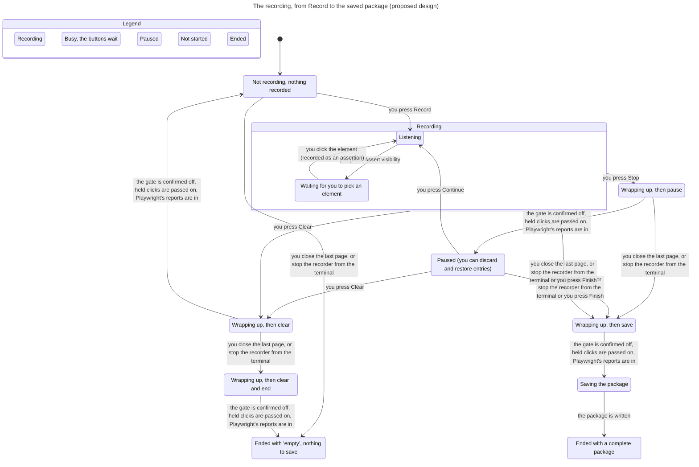
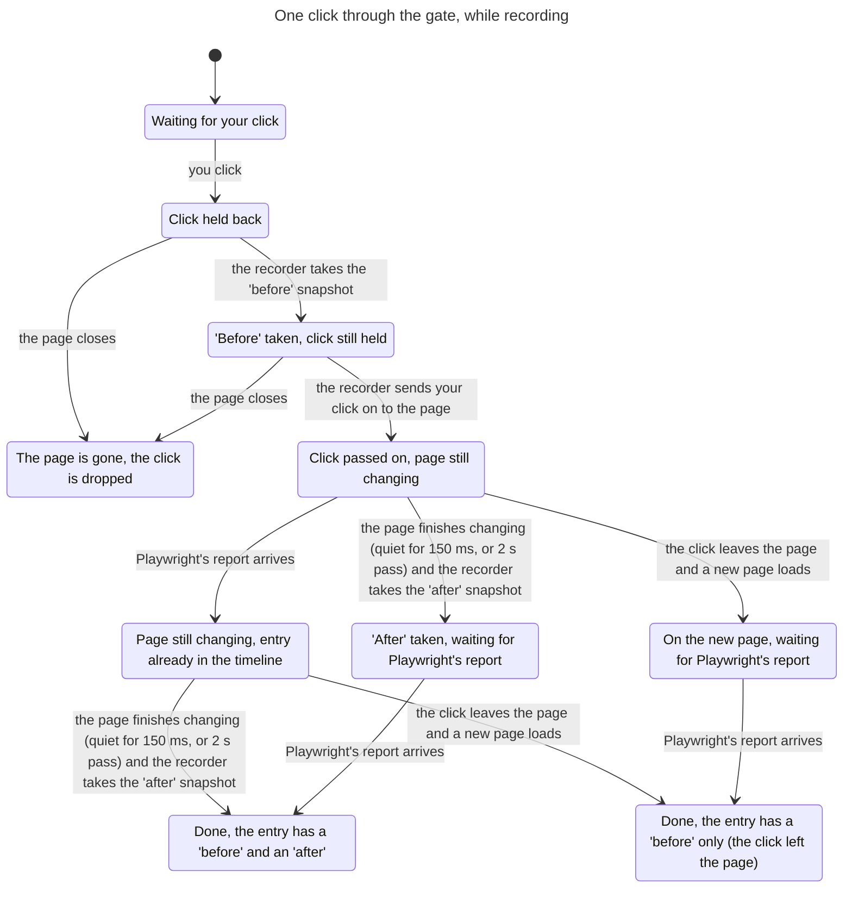

# Recorder lifecycle model: what the check found

This folder holds a model of the recorder's lifecycle and the results of checking it with the pstack `statechart` skill (TLA+ and the TLC model checker). No product code was written and nothing in the repository was changed.

## In short

- The **simplest design** that fits the settled decisions breaks rules 1, 3, 4, 5, 7, 8 and 9. Rules 2, 6 and 10 hold in it.
- With **eight added design pieces** (proposals, listed below, for the owner to decide) all ten rules hold, and so do three extra checks the design needs.
- Each proposal was also switched off on its own, with the rest left on, to show which rule it is needed for.
- One question stays open in every design: a click held back while the page navigates away lands on the new page.

## The two charts

Both charts were drawn by the tool from the checked model, with the proposals switched on.

### The recording's lifecycle



Not drawn, because they do not move between boxes: discard and restore (inside Paused), a second press of Finish (ignored), and the steps inside "Wrapping up".

### One click through the gate



Typing, a native select and a file upload skip the first three boxes: they reach the page at once, and their "before" comes with Playwright's report.

## The ten rules

"Simplest" is the simplest design that fits the decisions. "With proposals" has all eight proposals on.

| # | Rule | Simplest | With proposals |
|---|------|----------|----------------|
| 1 | A held click reaches the page exactly once | **breaks** | holds |
| 2 | Every recorded interaction gets one "before" and one "after" | holds | holds |
| 3 | While stopped: nothing added, clicks untouched, tracing runs | **breaks** (tracing part holds) | holds |
| 4 | Finish saves everything recorded up to that moment | **breaks** | holds |
| 5 | Clear leaves no entry and no discard decision | **breaks** | holds |
| 6 | Discard and restore only while paused; survive Continue | holds | holds |
| 7 | An assertion never carries changes | **breaks** | holds |
| 8 | Window, toolbar and engine end up showing the same state | **breaks** | holds |
| 9 | An outside end gives a complete package or a clear "empty" | **breaks** | holds |
| 10 | Pressing Finish twice saves once | holds | holds |

Three of the "holds" are weaker than they look. Say so plainly:

- **Rule 1, "not twice".** The model has no step that could deliver a click twice. That half rests on the gate recognising its own re-sent click, which the prototype verified, not on ordering.
- **Rule 6.** The engine checks its own state before it accepts a discard, so a stale window cannot sneak one in. The model has no other step that touches a decision. What was really checked: decisions are unchanged from the end of a pause until the save, and Clear removes them.
- **Rule 10.** Holds because a command that no longer applies is ignored (assumption 8). The model presses Finish a second time during wrap-up and saving, and combines Finish with a closed page and a terminal stop: always one save.

### Each break, with the shortest path the checker found

**Rule 1: a click you made never reaches the page.** Four different ways.

1. *The recorder ends while a click is still held.*
   You press Record. The page switches the gate on. You press Finish. You click before the page has switched the gate off: the gate holds the click. The page switches the gate off. The recorder finishes wrapping up, writes the package and ends. Nobody is left to pass the click on.
2. *The recorder ends and leaves the gate on.* This needs a browser that outlives the recorder (attach).
   You press Record. The page switches the gate on. You press Finish. The recorder finishes wrapping up without waiting for the page to confirm that the gate is off. You click: the gate, still on, holds it. The recorder writes the package and ends. That click, and every later click on that page, is swallowed until the page is reloaded.
3. *Assert visibility is pressed while a click is held.*
   You press Record. The page switches the gate on. You click: the gate holds it. You press Assert visibility. The recorder takes the "before" and passes the click on. Playwright, now in picking mode, swallows it and reports an assertion. The page never gets the click.
4. *You stop the recorder from the terminal twice.*
   You press Record. The page switches the gate on. You click: the gate holds it. You stop the recorder from the terminal. You stop it a second time: the recorder is killed with the click still held.

**Rule 3: while paused, the recorder still touches your clicks, or adds entries.** Four ways.

1. *Paused is shown before the page has switched the gate off.*
   You press Record. The page switches the gate on. You press Stop. The recorder shows Paused. You click: the gate, still on, holds the click.
2. *Assert visibility is left on.*
   You press Record. You press Assert visibility. You press Stop. The recorder shows Paused. You click: Playwright's picker swallows the click. The page never gets it.
3. *You navigate while paused, and the new page starts with the gate on.*
   You press Record. You press Stop. The recorder shows Paused. You click a link: it reaches the page untouched. The new page loads with the gate on, because the gate script starts switched on in every new document. You click: the gate holds it.
4. *Something you did while not recording shows up in the timeline.*
   You click before pressing Record. You press Record. Playwright's report for that click arrives now: it is added to the timeline.
   The same with a pause: you press Record, press Stop, the recorder shows Paused, you click, you press Continue, the report arrives and is added.

**Rule 4: your last click is missing from the saved package.**
You press Record. The page switches the gate on. You click: the gate holds it. You press Finish. The recorder takes the "before" and passes the click on. The page switches the gate off. The recorder finishes wrapping up and starts writing the package. Playwright's report for the click has not arrived yet (Playwright reports a click about half a second late), so the click is not in the package.
The shortest path is the same without the gate: Record, click in the instant before the gate is on, Finish.

**Rule 5: an old entry appears in the new, empty recording.**
You press Record. You click. You press Clear. The recorder clears. You press Record again. Playwright's report for the click from before Clear arrives now: it is added to the new timeline.

**Rule 7: an assertion's "changed before" is computed backwards.**
You press Record. The page switches the gate on. You click: the gate holds it, the recorder takes the "before" and passes it on. While the page is still settling you press Assert visibility and click an element. Both reports arrive: the assertion gets its one snapshot. Then the page settles and the first click gets its "after", which is now newer than the assertion's snapshot. The package credits the click with what changed after the assertion, and compares a newer snapshot with an older one to say what "changed before" the assertion.

**Rule 8: the toolbar keeps showing an old state.**
You click a link (before Record). The new page loads and its toolbar asks the recorder for the state. The recorder answers "not recording"; the answer is on its way. You press Record in the window. The recorder announces "recording"; the announcement reaches the toolbar. Then the older answer arrives and overwrites it. The toolbar shows "not recording", the window shows "recording", and nothing more is on its way. The window is narrow in time; it needs a page load and a command to cross.

**Rule 9: a half-written package.**
You press Record. You stop the recorder from the terminal. It wraps up and starts writing the package. You stop it from the terminal a second time: it is killed mid-write.
Read in the trial code, not run: `window/trial.mjs` line 295 registers the signal handler with `process.once`, so a second Ctrl+C does kill it. Line 264 only awaits Finish when the phase is still "recording", so even a first Ctrl+C during a running Finish closes the browser under it. The model assumes the opposite for a first stop (assumption 14).

## Three more checks the design needs

They are not among the ten rules. All three break in the simplest design and hold with the proposals.

**A. What you do reaches the page in the order you did it.** Breaks: typing overtakes a held key press or click.
You press Record. The page switches the gate on. You click (or press Enter): the gate holds it. You type: it reaches the page at once, before the held input is passed on.
Everyday case: type "milk", press Enter, type "eggs" quickly. Enter is held for one snapshot (13 to 16 ms on a small page, about 280 ms on a large one, per the prototype's findings). The first letters of "eggs" reach the field before Enter does. Read in the prototype, not run: `lib/gate.mjs` line 237 lets typing through whatever the gate is doing.

**B. Along the timeline, each "after" is no later than the next "before".** Breaks: typing while the previous click is still settling.
You press Record. The page switches the gate on. You click: held, "before" taken, passed on. While the page settles you type. Both reports arrive; the typing's "before" is the snapshot carried by its report. Then the page settles and the click gets its "after", taken after you typed. The click is credited with the typed text, and "changed before the typing" compares a newer snapshot with an older one.
Read in the prototype, not run: `lib/recorder.mjs` lines 198 and 344 cut a settle short only for a later *held* input.

**C. Nothing you did while recording is thrown away.** Breaks at Stop.
You press Record. You click. You press Stop before Playwright's report has arrived. The recorder shows Paused. The report arrives and is thrown away, because nothing may be added while paused.

## Proposals, for the owner to decide

None of these is a decision. Each was checked two ways: all on, every rule holds; this one off and the rest on, the listed rule breaks.

| # | Proposal | Needed for | Cost |
|---|----------|------------|------|
| P1 | **Wrap up before changing state.** Stop, Finish, Clear and an outside end first enter a short "wrapping up" state. It ends when (a) the page has confirmed the gate is off, (b) every held click has been passed on, (c) Playwright's reports for what was already done have arrived. Only then: Paused, save, or clear. The released recorder's "Finalizing" state is the same idea. | (a) rules 1 and 3. (b) rules 1, 3, 4, 5. (c) rules 4, 5, 7, checks B and C. | Stop, Finish and Clear are not instant. Expect about half a second after a click (Playwright's own delay). Buttons are disabled meanwhile. Needs a deadline for a report that never comes. One more state on both surfaces. |
| P2 | **Switch Playwright's own recorder off whenever not recording**, and out of picking mode when recording stops. | Rule 3 (ways 2 and 4). | One more private Playwright call (`setMode`, already used by the trial). Must happen after the reports are in (P1c), or a pending report may be lost. |
| P3 | **A newly loaded page starts with the gate in the state that matches the recorder.** | Rules 1 and 3 (way 3). Without it, P1 can also wait forever. | The gate script is installed once and cannot read the recorder's state as it starts. Either replace the script on every state change (needs a Playwright that can remove an init script), or start off and switch on (then clicks in a new page's first instant are not held). Only the first variant was checked. |
| P4 | **Any newer snapshot closes the previous interaction.** When a typing report or an assertion arrives while the previous interaction still waits for its "after", its snapshot becomes that "after". Held clicks already work this way in the prototype. | Rule 7, check B. | A small engine rule. Relies on reports arriving in order (assumption 16). |
| P5 | **While an input is held, everything after it waits its turn**, typing included, also when the gate is being switched off. | Check A. | The gate must hold back keystrokes it lets through today and re-send them. Re-sent typing is less faithful (paste, IME). Alternative: accept the overtaking as a known limit. |
| P6 | **Assert visibility takes effect only when no click is held.** | Rule 1 (way 3). | The Assert button reacts up to one snapshot later. |
| P7 | **A second terminal stop does not kill the recorder while it wraps up or saves.** | Rules 1 and 9. | Ctrl+C twice no longer quits at once; print "saving, please wait". A hard kill is still possible: writing to a temporary folder and renaming it at the end would cover that too. Not modelled. |
| P8 | **Each state message carries a counter; the toolbar ignores an older one.** | Rule 8. | One number per message. |

## Assumptions, as yes/no questions

The decisions left these open. The model took the answer in brackets.

1. A click held when Stop, Finish or Clear arrives is still passed on to the page, never dropped? [yes]
2. A click held, or made, during wrap-up after Stop or Finish is still recorded? [yes; after Clear it is cleared]
3. A second click while the first is still settling: the second's "before" also serves as the first's "after", with no further wait? [yes, as in the prototype]
4. At Stop and Finish, the last interaction's "after" is taken when wrap-up ends, without waiting out the full settle time? [the model has no clock, so it cannot tell these apart]
5. An assertion's single snapshot is the one carried by Playwright's report, taken when you pick? [yes]
6. Clear is allowed while recording and while paused, and returns to "not recording"; the next Record starts tracing again? [yes]
7. A recording that was started saves a package on an outside end, even with zero interactions; "empty" means Record was never pressed, or everything was cleared? [yes]
8. A command that no longer applies is ignored: not queued, never a toggle? [yes]
9. While wrapping up or saving, the buttons do nothing; only an outside end is still honoured? [yes]
10. If the page closes while a click is held, the click is dropped and the recording is still saved? [yes]
11. An interaction whose page closed before its "after" keeps its "before" only, like a navigation? [yes]
12. If the page navigates while a click is held, the click is passed on to the new page? [yes, which is rule 1 as written; see the open question]
13. If you close the page before Playwright's report for your last click arrives, that click may be missing from the package? [yes: the model treats the report as lost]
14. A terminal stop that arrives during wrap-up or saving joins the save already running? [yes; the trial code does not do this]
15. Playwright's reports arrive in the order you did things, and a report for typing or an assertion reaches the engine before the reply to any snapshot taken later? [assumed; worth a probe]
16. The window gets one ordered stream that starts with the full state, so a reload recovers? [assumed; the trial notes it has no such recovery yet]

## One open question the model cannot settle

**A held click can land on a page you did not click on.** Shortest path: you click a link (before Record). You press Record. The page switches the gate on. You click a button: held, "before" taken. The new page loads. The recorder passes the click on, to the new page, at the same position.
Rule 1 as written asks for exactly this ("reaches the page ... even if a navigation happens in between"). The alternative is to drop the click, which breaks rule 1 as written. Yes or no: should a held click be dropped when its page has navigated away?

## What the model leaves out

- **Time.** There is no clock. "150 ms", "2 s" and "half a second" are all "some time later". The model cannot say how long wrap-up takes, and it has no deadline: it assumes every report that is owed arrives, unless the page closes.
- **A click Playwright never reports.** Wrap-up would wait forever; a real design needs the deadline.
- **Snapshot and trace content**, the first snapshot of a visit, AI mode, MCP, highlight.
- **More than one page or tab, iframes, popups.** With iframes, "the page confirms the gate is off" means every frame.
- **Double clicks; key presses** (modelled as clicks); **select and upload** (modelled as typing).
- **The delay before the page follows a Playwright mode change.** Playwright's in-page script polls. A click in that delay can still be picked or reported.
- **Hard kills** (kill -9, crash, power loss) and **a trace lost because the browser vanished**.
- **Discard commands in flight, entry ids reused after Clear**, and **the window after the recorder has ended**.
- **Half a second of delay for a click the gate did not hold.** Its report is assumed to arrive promptly.

Bounds of what was checked: two things done on the page per run (clicks, typing, assertions, in any mix), one page with at most one navigation, one Clear, one toolbar and one window, up to two terminal stops. The proposed design was also checked with three things done on the page. Toolbar-and-window agreement was checked with one thing done on the page.

## Was each bug replayed against real code?

No. The design is not built, and the brief ruled out product code. Three findings were confirmed by reading the prototype (marked "read, not run" above). The rest are model results only. If a bug does not show when the design is built, suspect the model first.

## Runs behind this report

| Run | What it is | States explored | Result |
|---|---|---|---|
| `Proposed` | All proposals on. The ten rules (without 8) and the extra checks. | 544,733 | everything holds |
| `Progress` | All proposals on. Progress: a held click is always passed on; wrap-up and saving always end. | 544,733 | everything holds |
| `Surfaces` | All proposals on, toolbar and window lagging. Rule 8 and all other rules. | 1,351,230 | everything holds |
| `Simple` | The simplest design: every switch off. | stopped at the first break | breaks: R03b, X1, R01, R03a, R04, R09, X3, R05, X2, R07 |
| `SimpleRest` | The simplest design, only the rules the run above could not finish: 2, 3 (tracing), 6, 10. Long run. | 31,199,253 | everything holds |
| `No1-WaitGate` | Proposals on, except P1a (wait for the gate to be confirmed off). | stopped at the first break | breaks: R03a, R01, R03b |
| `No2-WaitHeld` | Proposals on, except P1b (wait for held clicks). | stopped at the first break | breaks: R01, R03a, R04, R05 |
| `No3-WaitReports` | Proposals on, except P1c (wait for Playwright's reports). | stopped at the first break | breaks: R04, X3, R05, X2, R07 |
| `No4-RecorderOff` | Proposals on, except P2. | stopped at the first break | breaks: R03b, R03a |
| `No5-GateStartsRight` | Proposals on, except P3. | stopped at the first break | breaks: X4, R03a, R01, R03b |
| `No6-NewerCloses` | Proposals on, except P4. | stopped at the first break | breaks: X2, R07 |
| `No7-KeepOrder` | Proposals on, except P5. | stopped at the first break | breaks: X1, X2 |
| `No8-AssertWaits` | Proposals on, except P6. | stopped at the first break | breaks: R01, R07, X2 |
| `No9-IgnoreSecondStop` | Proposals on, except P7. | stopped at the first break | breaks: R01, R09 |
| `Surfaces-No10-Revisions` | Proposals on, except P8, toolbar and window lagging. | stopped at the first break | breaks: R08 |
| `Path-No1-StuckAfterSaving` | Without P1a: the everyday path for rule 1, way 2. | stopped at the first break | breaks: T3 |
| `Path-No2-StuckAfterSaving` | Without P1b: the everyday path for rule 1, way 1. | stopped at the first break | breaks: T3 |
| `Path-No6-ClickThenTyping` | Without P4: the everyday paths for rule 7 and check B. | stopped at the first break | breaks: T1, T2 |
| `Question-WrongPage` | All proposals on: does a held click land on the page it was made on? | stopped at the first break | breaks: Q1 |
| `Probes` | All proposals on: nine situations the model must be able to reach. Each "break" here is a good sign. | stopped at the first break | breaks: P7, P8, P6, P9, P4, P5, P1, P3, P2 |
| `Chart-Lifecycle` | All proposals on, small: draws the lifecycle chart. | 220 | everything holds |
| `Chart-Gate` | All proposals on, one click: draws the gate chart. | 21 | everything holds |
| `more/More-No4-PausedClick` | Without P2: a click made while paused is recorded after Continue. | stopped at the first break | breaks: M1 |
| `more/More-No3-BeforeClear` | Without P1c: a click from before Clear comes back. | stopped at the first break | breaks: M2 |
| `more/More-No3-HeldClickSaved` | Without P1c: a held click made before Finish is missing from the package. | stopped at the first break | breaks: M3 |
| `more/More-Simple-Surfaces` | The simplest design, toolbar and window lagging: rule 8. | stopped at the first break | breaks: R08 |

In the result column, R01 to R10 are the ten rules. X1 is check A (order), X2 is check B (snapshots in time order), X3 is check C (nothing dropped), X4 is "wrap-up never waits for something that cannot come". T, M, P and Q names are the narrower checks, the probes and the open question.

A run that breaks stops at its first break. The tool then repeats it without that rule, up to 100,000 states each time, so a breaking run lists what breaks but cannot promise that the remaining rules hold. `SimpleRest` is the full run that settles the remaining rules for the simplest design. It was made before the last edits to the model, which touch only the toolbar-and-window part that this run has switched off.

Switch names in `Recorder.tla`: P1a `WaitGate`, P1b `WaitHeld`, P1c `WaitReports`, P2 `RecorderOff`, P3 `GateStartsRight`, P4 `NewerCloses`, P5 `KeepOrder`, P6 `AssertWaits`, P7 `IgnoreSecondStop`, P8 `Revisions`.

`Proposed3` is `Proposed` with three things done on the page instead of two: 24,095,359 states, everything holds. It takes about 35 minutes.

## Files

Everything is in `<scratchpad>/lifecycle-model`.

- `<scratchpad>/lifecycle-model/Recorder.tla`: the model. One switch per proposal.
- `<scratchpad>/lifecycle-model/gen-configs.sh`: writes every `.cfg` from one table.
- `<scratchpad>/lifecycle-model/view-paths.mjs`, `<scratchpad>/lifecycle-model/view-lifecycle.mjs`, `<scratchpad>/lifecycle-model/view-gate.mjs`: the plain-words labels.
- `<scratchpad>/lifecycle-model/run.sh`: runs one config. `<scratchpad>/lifecycle-model/run-all.sh`: runs all of them.
- `<scratchpad>/lifecycle-model/out/<config>/report.md`: the tool's report for each run. `chart.mmd` beside it for the charts and for each bug path.

Rerun everything (about 15 minutes; needs Devbox, and the network on a first run):

```sh
<scratchpad>/lifecycle-model/run-all.sh
```

Add `long` for the long runs: the simplest design's remaining rules (about 25 minutes) and three things done on the page (about 35 minutes).
